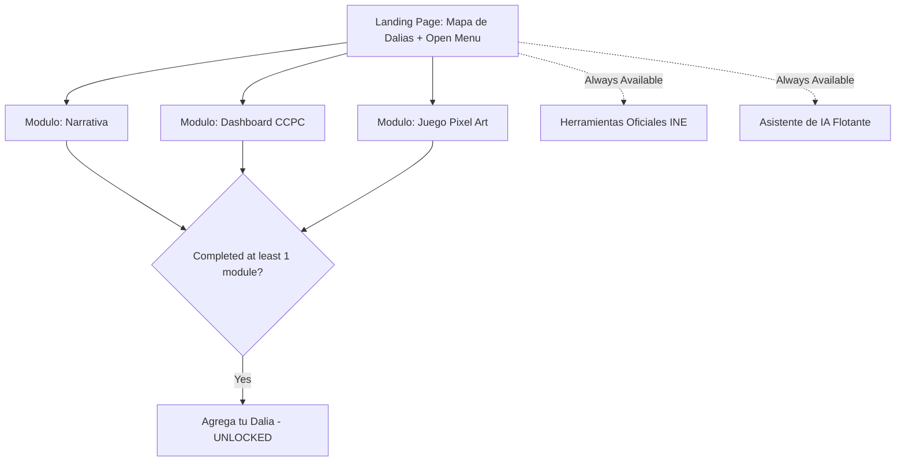

# PROJECT_CONTEXT.md — Domain & Technical Context

## 1. Hackathon Context & Challenge Overview

- **Hackathon:** Hackathon INE (Instituto Nacional Electoral)
- **Challenge:** Reto 3 — Comunicación y visualización con impacto público
- **Project Name:** Mapa de Dalias y Participación Ciudadana
- **Primary Target Audience:** Youth (Jóvenes)
- **Secondary Target Audience:** General public interested in civic engagement and electoral participation

---

## 2. Core Value Proposition & Differentiators

Most solutions for civic awareness focus on static infographics or emotional messaging ("why voting matters"). This project differentiates itself through four key pillars:

1. **Visible Social Proof (Mapa de Dalias):** Uses the dalia (Mexico's national flower) as a visual representation of individual civic awareness. Showing that "others like you are already informing themselves" leverages peer motivation without exposing personal identities.
2. **Actionable Intermediate Bridges:** Directly connects the desire to participate with concrete next steps (enforcing links to INE's official casilla locator, observer registration, and foreign voter procedures).
3. **Question-Driven CCPC Translation:** Converts complex INE CCPC data (.zip files per year) into intuitive, question-first visualizations (e.g., *"¿Por qué mi estado vota tan poco?"*), paired with dynamic chart selection (bars, lines, heatmaps).
4. **Complementary Pixel Art Game Mode:** Provides a youth-friendly alternative narrative channel through an interactive pixel art game featuring a simulated voting emulator and myth-busting challenges.

---

## 3. Navigation & UX Flow Architecture

### Open Access Model with Conditional Registration
All content modules are unlocked and accessible from the landing page from second 1. The registration action ("Agrega tu dalia") is locked with a visual badge until the user completes **at least one** of the three primary content modules.

### Module Completion Criteria
- **Narrativa:** User reaches the final reflection section (includes foreign voter context).
- **Dashboard CCPC:** User explores at least 1 full question (data + dynamic chart + context phrase).
- **Modo Juego:** User completes 1 full scene (1 myth buster or 1 voting simulation loop).

---

## 4. Feature Specifications

### 4.1. Mapa de Dalias (Interactive Map Engine)
- **Zoom Level 1 (National):** 1 dalia per state with active registrations. Dalia size scales dynamically based on aggregate count. States with 0 registrations hide dalia.
- **Zoom Level 2 (State Breakdown):** The main state dalia decomposes into regional dalias.
- **Zoom Level 3 (Municipal/Zonal):** Individual/grouped dalias located by approximate zone.
- **Interaction:** Clicking a dalia displays an aggregate card (topics explored, anonymous timestamp). No personal info, nicknames, or free text allowed.
- **Privacy Threshold:** If a municipality has $< 5$ registrations, aggregate automatically to state level to prevent re-identification in small communities.

### 4.2. Dashboard CCPC (Question-First Data Engine)
- **Question Selector:** Entry point presents social interest questions:
  - *"¿Por qué mi estado vota tan poco?"*
  - *"¿Quién participa más, hombres o mujeres?"*
  - *"¿Los jóvenes realmente votan menos que mis papás?"*
  - *"¿Ha cambiado la participación con los años?"*
- **Dynamic Visualization:** Chart type selected based on data structure:
  - *Categorical comparison:* Bar chart (Recharts)
  - *Time series trends:* Line chart (Visx/Recharts)
  - *Geographic comparison:* Heatmap / Choropleth map
- **Short Context:** 1-2 concise context sentences accompanying each chart response.

### 4.3. Modo Juego Pixel Art
- **Tech Integration:** Built in `packages/game` with PixiJS/Kaplay. Loaded dynamically in Next.js with `ssr: false`.
- **Role 1 (Desmentir Mitos):** INE officer sprite answers common youth electoral myths backed by CCPC data.
- **Role 2 (Simulador de Voto):** Step-by-step interactive simulator of how to vote at a polling station.
- **Cultural Respect & Inclusion:** Character sprites represent diverse regions (rural, urban, indigenous, migrant). Designs must avoid stereotypes and caricatures.

### 4.4. Asistente de IA (Civic Chatbot)
- **Scope:** FastAPI backend endpoint connecting to LLM API.
- **Constraint:** Context strictly limited to CCPC processed tables + platform editorial text. Refuses open political debate or unverified claims.
- **Languages:** Dual support for Spanish and Náhuatl.

### 4.5. Herramientas Oficiales INE (Bridge Section)
Direct, contextual links to official INE platforms:
- Ubicador de Casillas (including electores foráneos / voting outside home section)
- Registro de Observadores Electorales (Art. 217 LGIPE)
- Convocatoria de Funcionariado de Casilla

---

## 5. Technical Stack Summary

| Domain | Technology | Justification |
|---|---|---|
| Frontend Web | Next.js 14+ (App Router), TS, Tailwind CSS | Fast, accessible, SSR/SSG capable |
| UI Components | shadcn/ui, Radix UI | ARIA compliance out of the box |
| Maps Engine | react-simple-maps, d3-geo, INEGI GeoJSON | Smooth SVG zoom 1-3 control without paid APIs |
| Charts Engine | Recharts / Visx | Dynamic chart types tailored per dataset |
| Game Engine | PixiJS / Kaplay (in `packages/game`) | Lightweight 2D canvas, single monorepo build |
| Backend API | FastAPI (Python 3.11+) | Async performance, Pydantic validation |
| Database | PostgreSQL (Neon / Docker Compose) | Relational storage for aggregated counts & CCPC |
| Data Pipeline | Python ETL (`etl/ccpc_ingest.py`) | Offline parse of official INE CCPC ZIP files |
| Dev/Infra | Docker Compose | One-command local environment |

---

## 6. Ethical, Privacy & Accessibility Constraints

1. **Strict Anonymity:** Zero accounts, zero login forms, zero free-text comment fields.
2. **Re-identification Safeguard:** Minimum aggregation threshold ($N=5$) for municipal maps.
3. **Accessibility (WCAG 2.1 AA):**
   - Full keyboard navigation.
   - Narrative accessible table fallback for screen reader users unable to interact visually with SVG maps.
   - Colorblind-safe palettes (never rely solely on color to convey data).
   - Náhuatl i18n support.
