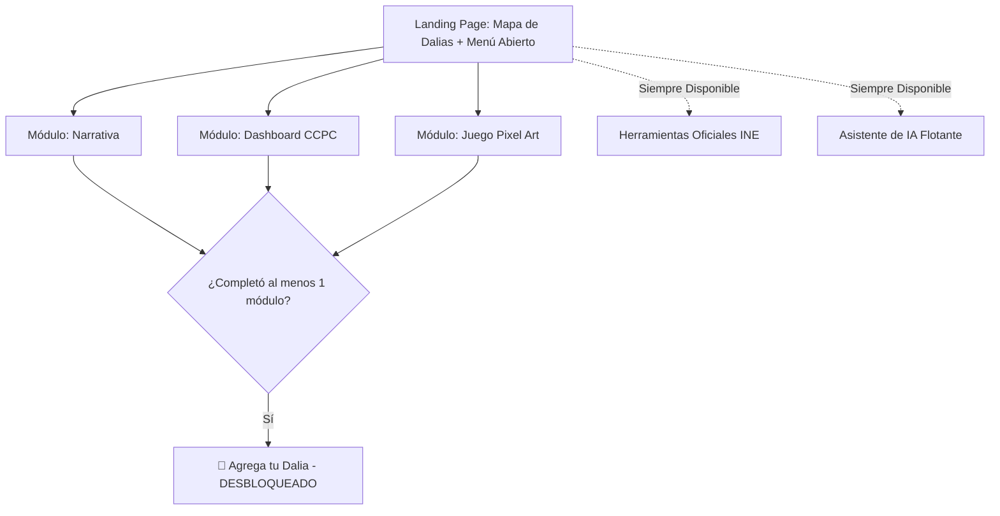
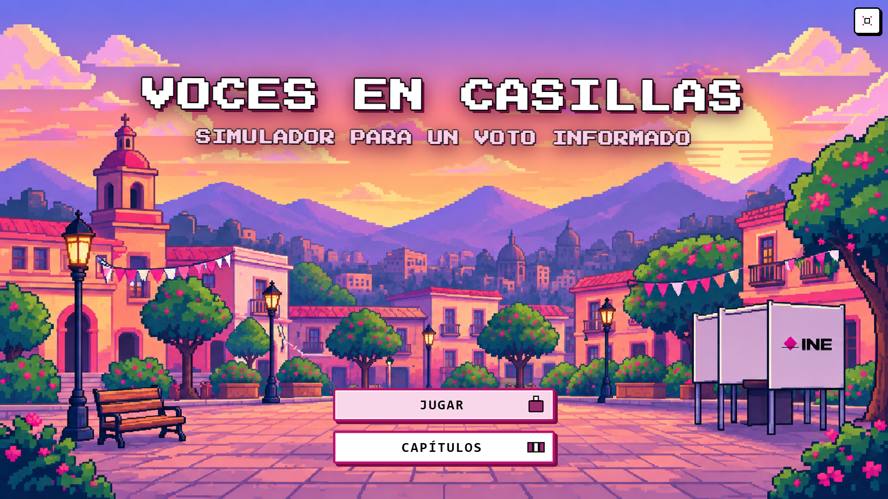
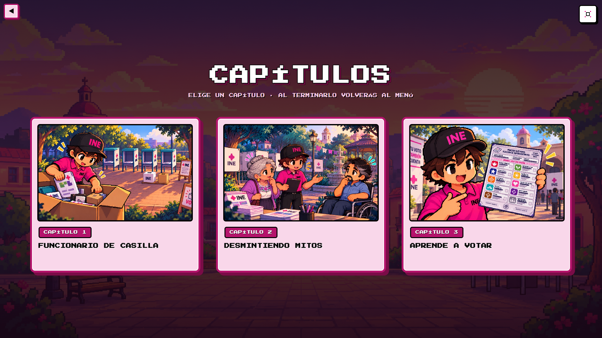
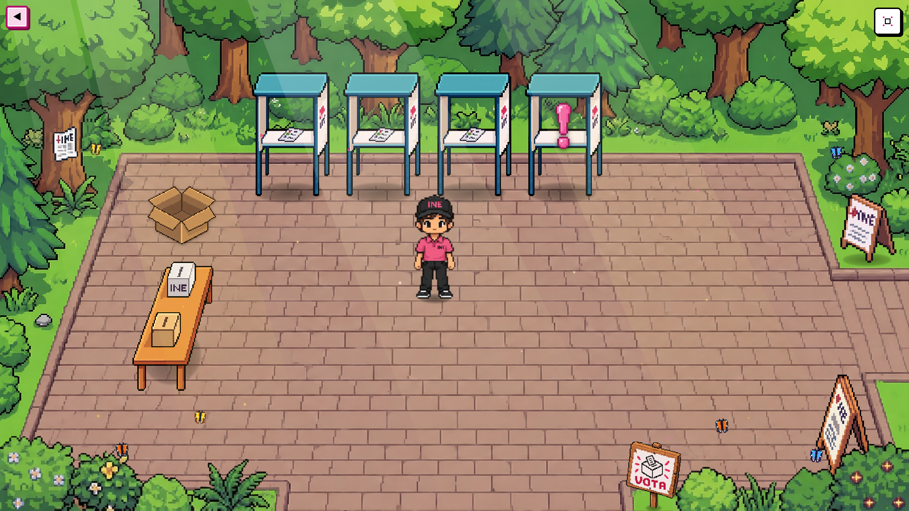
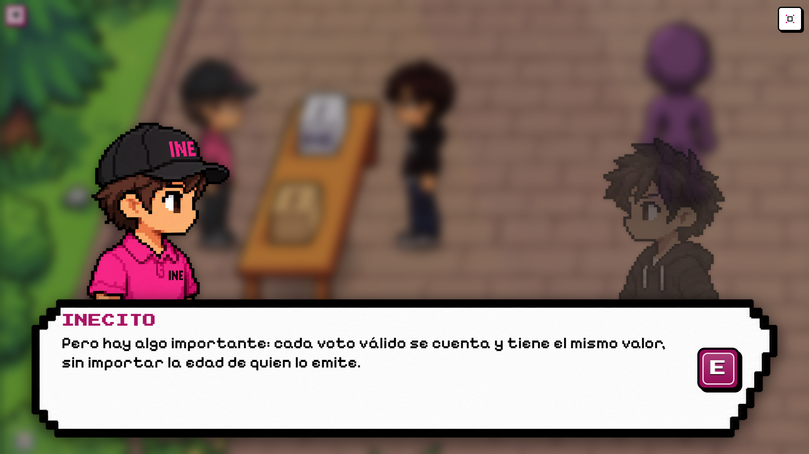
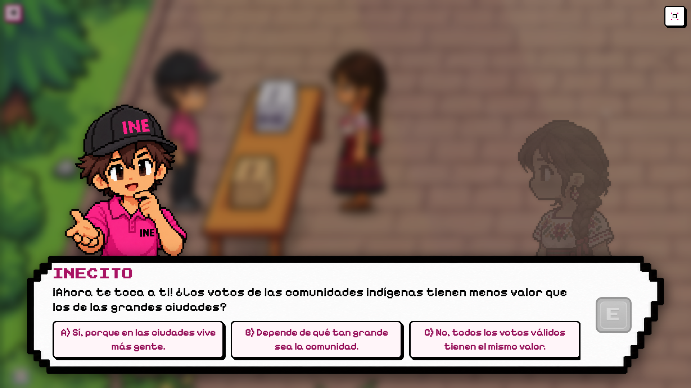
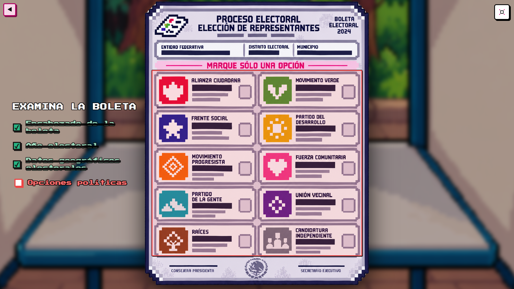

# 🌸 Mapa de Dalias y Participación Ciudadana

> **Reto 3: Comunicación y visualización con impacto público — Hackathon INE 2026**

[](https://nextjs.org/)
[](https://fastapi.tiangolo.com/)
[](https://www.postgresql.org/)
[](https://pixijs.com/)
[](https://tailwindcss.com/)
[](https://www.w3.org/WAI/standards-guidelines/wcag/)

Plataforma digital de participación cívica que transforma los datos de la **CCPC (Cultura Cívica y Participación Ciudadana)** del INE en una experiencia interactiva guiada por **prueba social**, visualización de datos orientada a preguntas sociales y un modo de juego en pixel art para jóvenes.

---

## 🌟 El Gancho Visual y Diferenciadores

1. **Prueba Social Visible (Mapa de Dalias):** Mapa interactivo de México representado con **dalias** (flor nacional de México) como unidad visual de participación informada. Hacer visible que _"otros como tú ya se están informando"_ genera una presión social positiva sin exponer identidades individuales.
2. **Traducción de la CCPC por Preguntas:** Convierte el dataset técnico de la CCPC del INE en respuestas intuitivas a preguntas de interés social (ej. _"¿Por qué mi estado vota tan poco?"_, _"¿Los jóvenes realmente votan menos que mis papás?"_).
3. **Modo Juego Pixel Art Complementario:** Alternativa narrativamente gamificada para el público joven, con diálogos para **desmentir mitos cívicos** y un **simulador interactivo de votación en casilla**.
4. **Puentes Intermedios Accionables:** Enlaces directos y contextuales a plataformas oficiales del INE (ubicador de casillas, casillas foráneas, registro de observadores electorales).

---

## 🗺️ Flujo de Navegación y Desbloqueo Condicionado

Acceso libre a todos los módulos desde el primer segundo. La acción de **"Agrega tu dalia"** (registro anónimo) se desbloquea al completar **al menos uno** de los tres módulos principales de contenido:



---

## 🎮 Modo de Juego Pixel Art: Inecito y la Casilla Electoral

Un videojuego retro interactivo en vista cenital/isométrica 2D desarrollado en **TypeScript y React**, diseñado para conectar con las juventudes y primeros votantes. Acompaña a **Inecito** a través de tres capítulos pedagógicos que simulan la jornada electoral: desde el armado cívico de la casilla y la atención a la ciudadanía con datos de la CCPC, hasta la experiencia inmersiva en primera persona (POV) del sufragio libre y secreto.

### Portada y Menú de Capítulos

El videojuego da la bienvenida con una pantalla de título retro arcade animada y un selector de capítulos interactivo que permite revivir cada fase de la jornada cívica o continuar la historia en orden cronológico.

|                        Menú de Inicio                        |                        Selector de Capítulos                        |
| :----------------------------------------------------------: | :-----------------------------------------------------------------: |
|  |  |
|           _Pantalla de inicio con estética arcade_           |  _Navegación libre entre los 3 capítulos de la jornada electoral_   |

---

### 📦 Capítulo 1: Montaje y Preparación de la Casilla

Inecito debe poner en orden la casilla electoral en la explanada cívica antes de la llegada de los ciudadanos. El jugador interactúa con los objetos dispersos para colocarlos en sus ubicaciones reglamentarias del INE.


_Inecito organizando mamparas, mesa directiva y señalización en la explanada_

- **Mecánica de Transporte:** Recoge mamparas electorales, la mesa directiva y el carteles de señalización electoral para colocarlos en los puntos marcados con iconos de exclamación.
- **Navegación Fuera de Pantalla:** Indicador de flecha dinámico a 60 FPS que proyecta con precisión la dirección hacia el objetivo más cercano cuando está fuera de la cámara.
- **Física Poligonal Continua:** Algoritmo de deslizamiento suave que evita atascos contra paredes, jardineras y la mesa.

---

### 👥 Capítulo 2: Atención Ciudadana y Mitos Electorales (CCPC)

Una vez abierta la casilla, cinco personajes diversos de la ciudadanía acuden a participar. A través de conversaciones interactivas y un sistema de trivias cívicas, se desmienten mitos comunes sobre las elecciones utilizando datos empíricos de la CCPC del INE.

|                 Llegada de Votantes a la Casilla                  |                     Desmitificación y Datos CCPC                      |
| :---------------------------------------------------------------: | :-------------------------------------------------------------------: |
|  |  |
|      _Fila de votantes con perfiles y demografías diversas_       |   _Trivia interactiva con justificación pedagógica oficial del INE_   |

- **Personajes (5 Perfiles Reales de la CCPC):**
  1. _Adulto Mayor (Doña Carmen / Tenantzin Carmen):_ Desmitificación de la edad límite para votar y alta participación histórica de personas mayores según datos de la CCPC.
  2. _Joven como Primer Votante (Mateo / Telpokatl Mateo):_ Superación de la apatía electoral, combate al mito de que «un voto no cambia nada» y el peso del padrón juvenil.
  3. _Personaje de Comunidades Indígenas (María / Maseualsiuatl María):_ Igualdad del valor de cada voto en comunidades rurales e indígenas frente a las urbes y pluralidad cultural.
  4. _Persona perteneciente a la Comunidad LGBT+ (Alex / Morgan):_ Protocolo del INE para garantizar el voto libre y sin discriminación por identidad o expresión de género.
  5. _Persona con Discapacidad (Don Roberto / Tlacatl Roberto):_ Protocolos de accesibilidad universal, mamparas adaptadas, plantillas Braille y trato preferente para un voto autónomo.

---

### 🗳️ Capítulo 3: Aprende a Votar (Simulador de Voto)

La culminación de la experiencia cívica: el jugador asume el rol de elector, se aproxima a una mampara electoral interactiva e ingresa a una vista inmersiva en primera persona (_Point of View_).


_Inspección minuciosa de la boleta electoral y marcado de la opción ciudadana_

- **Inspección Dinámica de la Boleta:** Inspecciona la boleta electoral y conoce sus apartados.
- **Validación Oficial de Votos:**
  - _Voto Válido:_ Exactamente 1 recuadro marcado (cruz pixel art con retroalimentación sonora).
  - _Voto Nulo:_ Más de una opción marcada simultáneamente o boleta depositada en blanco.
- **Secuencia Cívica Completa:**
  1. Doblar la boleta para garantizar el secreto del voto.
  2. Caminar hacia la mesa directiva con la boleta en mano.
  3. Depositar la boleta en la urna blanca ante los funcionarios de casilla.
  4. Cierre reflexivo con las 8 máximas de educación ciudadana y conclusión de la jornada.

---

### ⌨️ Controles del Videojuego

| Acción                               | Teclas / Control                                                                                                                  |
| :----------------------------------- | :-------------------------------------------------------------------------------------------------------------------------------- |
| **Mover a Inecito**                  | <kbd>W</kbd> <kbd>A</kbd> <kbd>S</kbd> <kbd>D</kbd> o Flechas direccionales (<kbd>↑</kbd> <kbd>←</kbd> <kbd>↓</kbd> <kbd>→</kbd>) |
| **Interactuar / Recoger / Colocar**  | Tecla <kbd>E</kbd>, <kbd>Espacio</kbd> o <kbd>Enter</kbd> (o clic directo en pantalla)                                            |
| **Examinar / Marcar Boleta**         | Clic izquierdo con el ratón o <kbd>Enter</kbd> / <kbd>Espacio</kbd>                                                               |
| **Pantalla Completa (_Fullscreen_)** | Tecla <kbd>F</kbd> o botón en la esquina superior derecha                                                                         |
| **Menú / Selector de Capítulos**     | Botón de retorno en la esquina superior izquierda                                                                                 |

---

### ⚙️ Innovaciones Técnicas del Motor (`packages/game`)

| Característica                                | Descripción Técnica                                                                                                                                                                                                                                    |
| :-------------------------------------------- | :----------------------------------------------------------------------------------------------------------------------------------------------------------------------------------------------------------------------------------------------------- |
| **Física y Colisiones Suaves**                | Sistema de colisiones por polígonos que implementa deslizamiento vectorial continuo (`tryPolygonWallSlide` y `applyMesaSlidingDeltas`), eliminando oscilaciones y rebotes molestos al colisionar con la mesa directiva o los límites de la explanada.  |
| **Waypoint Arrow (Fuera de Cámara)**          | Indicador de navegación pixel art (`OffscreenWaypointArrow`) que calcula en tiempo real la proyección elíptica sobre los bordes de la pantalla (60 FPS) y apunta con precisión hacia el objetivo o mampara más cercana cuando está fuera del encuadre. |
| **Prevención de Scroll Nativo**               | Interceptación de `ArrowUp`, `ArrowDown` y `Space` para permitir jugar en modo ventana sin que la página web se desplace verticalmente, protegiendo a su vez campos de texto e inputs.                                                                 |
| **Profundidad Z-Index Dinámica**              | Algoritmo de profundidad visual que ordena capas entre el protagonista, votantes, mesa y mamparas en tiempo real con caché memoizado $O(N)$.                                                                                                           |
| **Inclusión Lingüística (Bilingüe)**          | Soporte bilingüe integral en **Español** y **Náhuatl** para todos los diálogos de apertura, explicaciones de boleta, reflexiones cívicas y textos de la interfaz.                                                                                      |
| **Batería de Pruebas Automatizadas**          | **221 pruebas unitarias** que certifican física, cinemáticas, NPCs, lógica del simulador de voto y waypoints (`pnpm --filter @mapa-dalias/game test`).                                                                                                 |

---

## 🚀 Inicio Rápido (Setup Local en 2 Pasos)

### Prerrequisitos

- [Docker & Docker Compose](https://www.docker.com/)
- [Node.js v18+](https://nodejs.org/) y [pnpm](https://pnpm.io/)

### Paso 1: Levantar Backend & PostgreSQL con Docker (1 Comando)

```bash
docker compose -f infra/docker-compose.yml up -d
```

_(Docker iniciará PostgreSQL, ejecutará las migraciones de Alembic e insertará los datos iniciales de la CCPC en `http://localhost:8000`)._

### Paso 2: Levantar el Frontend & Motor de Juego (`pnpm dev`)

```bash
pnpm install
pnpm dev
```

_(Abre [`http://localhost:3000`](http://localhost:3000) en tu navegador y haz clic en **MODO DE JUEGO PIXEL ART**)._

### Ejecutar Pruebas Automatizadas del Videojuego

```bash
pnpm --filter @mapa-dalias/game test
```

---

## 🛠️ Estructura del Monorepo

```
sadaPops/
├── apps/
│   └── web/                                # Next.js 14 App Router (TypeScript, Tailwind, shadcn/ui)
│       ├── app/                            # Rutas principales y layout
│       └── src/features/
│           ├── mapa-dalias/                # Mapa SVG Zoom 1-3, dalias dinámicas, GeoJSON INEGI
│           ├── narrativa/                  # Storytelling e información de electores foráneos
│           ├── dashboard-ccpc/             # Gráficas por preguntas (Recharts/Visx)
│           ├── juego/                      # Wrapper dinámico (ssr: false) para @mapa-dalias/game
│           ├── registro/                   # Hook useSesionAnonima y desbloqueo de dalia
│           └── asistente-ia/               # Chatbot flotante (Español / Náhuatl)
│
├── packages/
│   ├── game/                               # Paquete 2D en PixiJS/Kaplay (@mapa-dalias/game)
│   │   ├── src/                            # Escenas (Montaje, Mitos CCPC, Simulador de Voto POV)
│   │   └── tests/                          # 221 pruebas automatizadas de motor y lógica
│   └── types/                              # Interfaces compartidas TS (@mapa-dalias/types)
│
├── backend/                                # Backend en Python FastAPI
│   ├── app/                                # Routers, modelos SQLAlchemy, esquemas Pydantic
│   ├── etl/ccpc_ingest.py                  # Script ETL de ingesta de datos CCPC del INE
│   ├── Dockerfile
│   └── entrypoint.sh                       # Script automatizado para Docker
│
├── docs/                                   # Documentación completa del proyecto
│   ├── capturas/                           # Capturas de pantalla del videojuego y plataforma
│   ├── PROJECT_CONTEXT.md
│   ├── SETUP.md
│   ├── WORKFLOW.md
│   ├── PLAN_DE_DESARROLLO.md
│   ├── DEPLOY.md
│   └── propuesta-mapa-dalias.md
│
├── infra/
│   └── docker-compose.yml                  # Servicios PostgreSQL + FastAPI
├── GEMINI.md                               # Reglas maestras para Agentes de IA
├── README.md                               # Documentación principal
└── LICENSE                                 # Licencia MIT
```

---

## 🔒 Privacidad, Anonimato y Accesibilidad

- **Cero PII (Información Personal Identificable):** Sin inicio de sesión, sin recolección de correo ni campos de texto libre. Registro anónimo local vía UUID (`useSesionAnonima`).
- **Umbral Anti-Reidentificación ($N=5$):** En el Zoom 3 del mapa municipal, si una región tiene menos de 5 registros, los datos se consolidan automáticamente al nivel estatal para proteger la privacidad en comunidades pequeñas.
- **Accesibilidad WCAG 2.1 AA:** Botón para cambiar a vista alternativa en tabla semántica (`<TablaAccesibleDalias />`) para lectores de pantalla. Ratios de contraste verificados.
- **Inclusión Lingüística:** Soporte bilingüe en Español y Náhuatl para el Asistente de IA y la interfaz.

---

## 📚 Documentación del Proyecto (`docs/`)

- 📖 **[`docs/SETUP.md`](docs/SETUP.md):** Guía detallada de inicialización local.
- 📋 **[`docs/PLAN_DE_DESARROLLO.md`](docs/PLAN_DE_DESARROLLO.md):** Plan de desarrollo por Sprints y asignación de tareas por desarrollador (Dev 1 a 4).
- 🧭 **[`docs/PROJECT_CONTEXT.md`](docs/PROJECT_CONTEXT.md):** Contexto técnico y de dominio completo.
- 🚀 **[`docs/DEPLOY.md`](docs/DEPLOY.md):** Guía de despliegue en producción (Vercel, Google Cloud Run, Neon PostgreSQL).
- 📜 **[`docs/WORKFLOW.md`](docs/WORKFLOW.md):** Hoja de ruta del MVP a 3 semanas.
- 📄 **[`docs/propuesta-mapa-dalias.md`](docs/propuesta-mapa-dalias.md):** Propuesta original del proyecto.
- 🛠️ **[`GEMINI.md`](GEMINI.md):** Reglas maestras para Agentes de IA.

---

## ⚖️ Licencia y Créditos

Desarrollado para el **Reto 3 del Hackathon INE 2026** por el equipo **SadaPops**.
