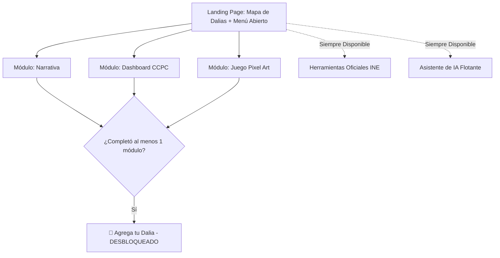

# 🌸 Mapa de Dalias y Participación Ciudadana

> **Reto 3: Comunicación y visualización con impacto público — Hackathon INE 2026**

[](https://nextjs.org/)
[](https://fastapi.tiangolo.com/)
[](https://www.postgresql.org/)
[](https://pixijs.com/)
[](https://tailwindcss.com/)
[](https://www.w3.org/WAI/standards-guidelines/wcag/)

Plataforma digital de participación cívica que transforma los datos de la **CCPC (Cultura Cívica y Participación Ciudadana)** del INE en una experiencia interactiva guiada por **prueba social**, visualización de datos orientada a preguntas sociales y un modo de juego en pixel art para jóvenes.

---

## 🌟 El Gancho Visual y Diferenciadores

1. **Prueba Social Visible (Mapa de Dalias):** Mapa interactivo de México representado con **dalias** (flor nacional de México) como unidad visual de participación informada. Hacer visible que *"otros como tú ya se están informando"* genera una presión social positiva sin exponer identidades individuales.
2. **Traducción de la CCPC por Preguntas:** Convierte el dataset técnico de la CCPC del INE en respuestas intuitivas a preguntas de interés social (ej. *"¿Por qué mi estado vota tan poco?"*, *"¿Los jóvenes realmente votan menos que mis papás?"*).
3. **Modo Juego Pixel Art Complementario:** Alternativa narrativamente gamificada para el público joven, con diálogos para **desmentir mitos cívicos** y un **simulador interactivo de votación en casilla**.
4. **Puentes Intermedios Accionables:** Enlaces directos y contextuales a plataformas oficiales del INE (ubicador de casillas, casillas foráneas, registro de observadores electorales).

---

## 🗺️ Flujo de Navegación y Desbloqueo Condicionado

Acceso libre a todos los módulos desde el primer segundo. La acción de **"Agrega tu dalia"** (registro anónimo) se desbloquea al completar **al menos uno** de los tres módulos principales de contenido:



---

## 🚀 Inicio Rápido (Setup Local en 2 Pasos)

### Prerrequisitos
- [Docker & Docker Compose](https://www.docker.com/)
- [Node.js v18+](https://nodejs.org/) y [pnpm](https://pnpm.io/)

### Paso 1: Levantar Backend & PostgreSQL con Docker (1 Comando)
```bash
docker compose -f infra/docker-compose.yml up -d
```
*(Docker iniciará PostgreSQL, ejecutará las migraciones de Alembic e insertará los datos iniciales de la CCPC en `http://localhost:8000`).*

### Paso 2: Levantar el Frontend & Motor de Juego (`pnpm dev`)
```bash
pnpm install
pnpm dev
```
*(Abre [`http://localhost:3000`](http://localhost:3000) en tu navegador).*

---

## 🛠️ Estructura del Monorepo

```
sadaPops/
├── apps/
│   └── web/                                # Next.js 14 App Router (TypeScript, Tailwind, shadcn/ui)
│       ├── app/                            # Rutas principales y layout
│       └── src/features/
│           ├── mapa-dalias/                # Mapa SVG Zoom 1-3, dalias dinámicas, GeoJSON INEGI
│           ├── narrativa/                  # Storytelling e información de electores foráneos
│           ├── dashboard-ccpc/             # Gráficas por preguntas (Recharts/Visx)
│           ├── juego/                      # Wrapper dinámico (ssr: false) para @mapa-dalias/game
│           ├── registro/                   # Hook useSesionAnonima y desbloqueo de dalia
│           └── asistente-ia/               # Chatbot flotante (Español / Náhuatl)
│
├── packages/
│   ├── game/                               # Paquete 2D en PixiJS/Kaplay (@mapa-dalias/game)
│   │   └── src/                            # Escenas de Desmentir Mitos y Simulador de Voto
│   └── types/                              # Interfaces compartidas TS (@mapa-dalias/types)
│
├── backend/                                # Backend en Python FastAPI
│   ├── app/                                # Routers, modelos SQLAlchemy, esquemas Pydantic
│   ├── etl/ccpc_ingest.py                  # Script ETL de ingesta de datos CCPC del INE
│   ├── Dockerfile
│   └── entrypoint.sh                       # Script automatizado para Docker
│
├── infra/
│   └── docker-compose.yml                  # Servicios PostgreSQL + FastAPI
└── PLAN_DE_DESARROLLO.md                   # Hoja de ruta por Sprints y asignación de tareas
```

---

## 🔒 Privacidad, Anonimato y Accesibilidad

- **Cero PII (Información Personal Identificable):** Sin inicio de sesión, sin recolección de correo ni campos de texto libre. Registro anónimo local vía UUID (`useSesionAnonima`).
- **Umbral Anti-Reidentificación ($N=5$):** En el Zoom 3 del mapa municipal, si una región tiene menos de 5 registros, los datos se consolidan automáticamente al nivel estatal para proteger la privacidad en comunidades pequeñas.
- **Accesibilidad WCAG 2.1 AA:** Botón para cambiar a vista alternativa en tabla semántica (`<TablaAccesibleDalias />`) para lectores de pantalla. Ratios de contraste verificados.
- **Inclusión Lingüística:** Soporte bilingüe en Español y Náhuatl para el Asistente de IA y la interfaz.

---

## 📚 Documentación del Proyecto

- 📖 **[`SETUP.md`](SETUP.md):** Guía detallada de inicialización local.
- 📋 **[`PLAN_DE_DESARROLLO.md`](PLAN_DE_DESARROLLO.md):** Plan de desarrollo por Sprints y asignación de tareas por desarrollador (Dev 1 a 4).
- 🧭 **[`PROJECT_CONTEXT.md`](PROJECT_CONTEXT.md):** Contexto técnico y de dominio completo.
- 🚀 **[`DEPLOY.md`](DEPLOY.md):** Guía de despliegue en producción (Vercel, Google Cloud Run, Neon PostgreSQL).
- 🛠️ **[`GEMINI.md`](GEMINI.md):** Reglas maestras para Agentes de IA.

---

## ⚖️ Licencia y Créditos

Desarrollado para el **Reto 3 del Hackathon INE 2026** por el equipo **SadaPops**.
