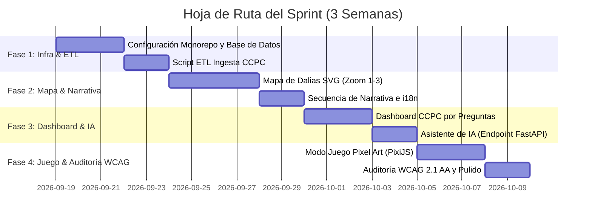

# WORKFLOW.md — Hoja de Ruta de Ejecución del MVP a 3 Semanas (Hackathon INE)

Esta hoja de ruta detalla el plan de ejecución paso a paso para construir y entregar **Mapa de Dalias y Participación Ciudadana** dentro de un sprint de 3 semanas.

---

## Visión General del Sprint e Hitos



---

## Fase 1: Infraestructura, Monorepo e Ingesta (Días 1 - 5)

### Objetivos
- Inicializar el monorepo con pnpm (`apps/web`, `packages/game`, `packages/types`, `backend`).
- Configurar Docker Compose con PostgreSQL y FastAPI.
- Ejecutar el script ETL offline `ccpc_ingest.py` para parsear el archivo ZIP de la CCPC del INE e insertar los datos en tablas SQL limpias.

### Lista de Tareas
- [ ] Inicializar `pnpm-workspace.yaml` y `turbo.json`.
- [ ] Crear proyecto Next.js 14 App Router en `apps/web` con Tailwind CSS y shadcn/ui.
- [ ] Crear app de FastAPI en `backend` con conexión asíncrona de SQLAlchemy a Postgres.
- [ ] Implementar `backend/etl/ccpc_ingest.py` y verificar las tablas `ccpc_participacion_estado` y `ccpc_participacion_edad`.
- [ ] Configurar `packages/types` para contratos TypeScript compartidos.

### Comandos de Verificación
```bash
# Verificar infraestructura local
docker compose up -d

# Verificar conexión a base de datos y migraciones en backend
cd backend && pytest tests/test_db_connection.py

# Verificar resultados de la ingesta ETL
python etl/ccpc_ingest.py --file ../data/raw/ccpc_ine_official.zip
```

---

## Fase 2: Motor del Mapa de Dalias y Narrativa (Días 6 - 11)

### Objetivos
- Construir el mapa SVG interactivo de México utilizando `react-simple-maps` y d3.
- Implementar los niveles de Zoom 1, 2 y 3 (Nacional $\to$ Estatal $\to$ Municipal).
- Aplicar la Regla 02 de umbral ($N=5$) en el Zoom 3 para evitar la re-identificación.
- Implementar el flujo de la Narrativa (problemas $\to$ mecanismo $\to$ reflexión $\to$ electores foráneos).

### Lista de Tareas
- [ ] Cargar mapas GeoJSON del INEGI en `apps/web/public/geojson/`.
- [ ] Crear componentes en `features/mapa-dalias` (NationalMap, StateMap, DaliaCard).
- [ ] Implementar el endpoint `GET /api/v1/dalias/aggregate` en FastAPI retornando conteos agregados por estado/municipio.
- [ ] Construir componentes en `features/narrativa` con tarjetas interactivas de reflexión.
- [ ] Implementar hook de estado de desbloqueo `useProgresoSesion`.

### Comandos de Verificación
```bash
# Ejecutar servidor de desarrollo web
pnpm --filter web dev

# Probar endpoints de la API de Dalias
cd backend && pytest tests/features/test_dalias.py
```

---

## Fase 3: Dashboard CCPC y Asistente de IA Acotado (Días 12 - 16)

### Objetivos
- Construir el Dashboard de la CCPC orientado a preguntas (`features/dashboard-ccpc`).
- Implementar selector de gráficas dinámicas (barras Recharts, líneas, mapa de calor).
- Construir el widget flotante del asistente de IA y su endpoint en FastAPI.
- Integrar puentes a herramientas oficiales del INE (casillas, observadores, foráneos).

### Lista de Tareas
- [ ] Implementar interfaz del selector de preguntas con las 4 preguntas cívicas principales.
- [ ] Crear componentes de gráficas dinámicas (BarChart, TimeLineChart, HeatMapChart).
- [ ] Construir endpoint `POST /api/v1/asistente/chat` en FastAPI con acotamiento de contexto.
- [ ] Construir widget de chat `features/asistente-ia` con soporte para Markdown.
- [ ] Agregar tarjetas de enlaces en `features/herramientas-oficiales`.

### Comandos de Verificación
```bash
# Probar consultas de la API del Dashboard
cd backend && pytest tests/features/test_dashboard.py

# Probar límite de dominio del Asistente de IA
cd backend && pytest tests/features/test_asistente.py
```

---

## Fase 4: Juego Pixel Art, Auditoría WCAG y Pulido Final (Días 17 - 21)

### Objetivos
- Construir escenas del juego en PixiJS/Kaplay en `packages/game` (Desmentir mitos y Simulador de voto).
- Cargar el juego en Next.js mediante importación dinámica con `ssr: false` (`GameLoader.tsx`).
- Realizar auditoría de accesibilidad WCAG 2.1 AA (navegación por teclado, alto contraste, vista de tabla accesible narrada).
- Agregar soporte i18n para Náhuatl (`src/i18n/nah.json`).

### Lista de Tareas
- [ ] Implementar el motor PixiJS y hojas de sprites en `packages/game`.
- [ ] Montar el juego en `apps/web/src/features/juego/GameLoader.tsx`.
- [ ] Implementar fallback para lector de pantalla `<TablaAccesibleDalias />`.
- [ ] Agregar selector de idioma Náhuatl y actualizar diccionarios.
- [ ] Ejecutar prueba de flujo de usuario de principio a fin y preparar documentación de presentación.

### Comandos de Verificación
```bash
# Compilar el monorepo completo para producción
pnpm build

# Ejecutar herramienta de auditoría de accesibilidad
npx axe-cli http://localhost:3000
```
