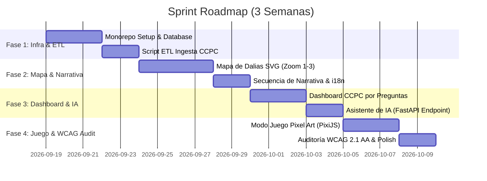

# WORKFLOW.md — 3-Week MVP Execution Roadmap (Hackathon INE)

This roadmap outlines the step-by-step execution plan for building and delivering **Mapa de Dalias y Participación Ciudadana** within a 3-week sprint.

---

## Sprint Overview & Milestones



---

## Phase 1: Infrastructure, Monorepo & Ingestion (Days 1 - 5)

### Objectives
- Initialize pnpm monorepo (`apps/web`, `packages/game`, `packages/types`, `backend`).
- Configure Docker Compose with PostgreSQL & FastAPI.
- Execute offline ETL script `ccpc_ingest.py` to parse INE CCPC dataset ZIP file into clean SQL tables.

### Execution Checklist
- [ ] Initialize `pnpm-workspace.yaml` and `turbo.json`.
- [ ] Create Next.js 14 App Router project in `apps/web` with Tailwind CSS & shadcn/ui.
- [ ] Create FastAPI app in `backend` with SQLAlchemy async connection to Postgres.
- [ ] Implement `backend/etl/ccpc_ingest.py` and verify `ccpc_participacion_estado` & `ccpc_participacion_edad` tables.
- [ ] Setup `packages/types` for shared TypeScript contracts.

### Verification Commands
```bash
# Verify local infrastructure
docker compose up -d

# Verify backend database connection & migrations
cd backend && pytest tests/test_db_connection.py

# Verify ETL ingestion results
python etl/ccpc_ingest.py --file ../data/raw/ccpc_ine_official.zip
```

---

## Phase 2: Dalias Map Engine & Storytelling (Days 6 - 11)

### Objectives
- Build interactive SVG map of Mexico using `react-simple-maps` & d3.
- Implement Zoom Levels 1, 2, and 3 (National $\to$ State $\to$ Municipal).
- Enforce Rule 02 threshold ($N=5$) on Zoom 3 to prevent re-identification.
- Implement Narrativa flow (problems $\to$ mechanics $\to$ reflection $\to$ foreign voters).

### Execution Checklist
- [ ] Load INEGI GeoJSON maps into `apps/web/public/geojson/`.
- [ ] Create `features/mapa-dalias` components (NationalMap, StateMap, DaliaCard).
- [ ] Implement backend `GET /api/v1/dalias/aggregate` endpoint returning aggregate count per state/municipality.
- [ ] Build `features/narrativa` components with interactive reflection cards.
- [ ] Implement unlock status hook `useProgresoSesion`.

### Verification Commands
```bash
# Run web app development server
pnpm --filter web dev

# Test Dalias API endpoints
cd backend && pytest tests/features/test_dalias.py
```

---

## Phase 3: Dashboard CCPC & Scoped AI Assistant (Days 12 - 16)

### Objectives
- Build question-oriented CCPC Dashboard (`features/dashboard-ccpc`).
- Implement dynamic chart selector (Recharts bar, line, heatmap).
- Build scoped AI assistant floating chat widget and FastAPI endpoint.
- Integrate official INE tool bridges (casillas, observadores, foráneos).

### Execution Checklist
- [ ] Implement question selector interface with 4 core civic questions.
- [ ] Create dynamic chart components (BarChart, TimeLineChart, HeatMapChart).
- [ ] Build FastAPI `POST /api/v1/asistente/chat` endpoint with context grounding.
- [ ] Build `features/asistente-ia` chat widget with markdown support.
- [ ] Add `features/herramientas-oficiales` link cards.

### Verification Commands
```bash
# Test Dashboard API queries
cd backend && pytest tests/features/test_dashboard.py

# Test AI Assistant prompt boundary
cd backend && pytest tests/features/test_asistente.py
```

---

## Phase 4: Pixel Art Game, Accessibility Audit & Polish (Days 17 - 21)

### Objectives
- Build PixiJS/Kaplay game scenes in `packages/game` (Myth buster & Voting simulator).
- Load game in Next.js via dynamic import with `ssr: false` (`GameLoader.tsx`).
- Conduct WCAG 2.1 AA accessibility audit (keyboard navigation, high contrast, screen reader narrated table view).
- Add Náhuatl i18n support (`src/i18n/nah.json`).

### Execution Checklist
- [ ] Implement `packages/game` PixiJS engine and sprite sheets.
- [ ] Mount game in `apps/web/src/features/juego/GameLoader.tsx`.
- [ ] Implement `<TablaAccesibleDalias />` screen reader fallback for map.
- [ ] Add Náhuatl language toggle and update dictionary files.
- [ ] Run full end-to-end user flow test and prepare presentation documentation.

### Verification Commands
```bash
# Build complete monorepo for production
pnpm build

# Run accessibility check tool
npx axe-cli http://localhost:3000
```
