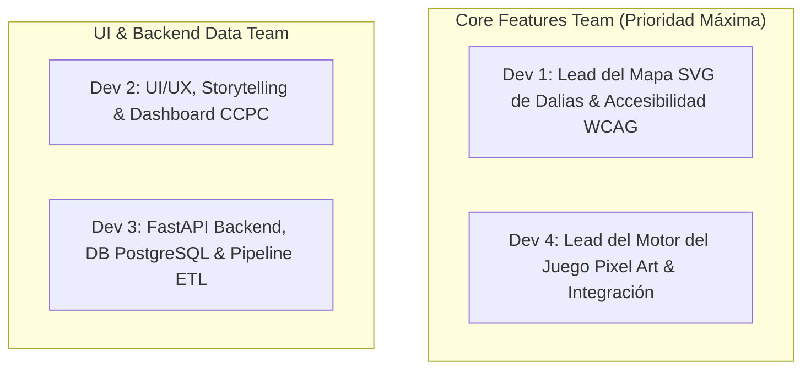
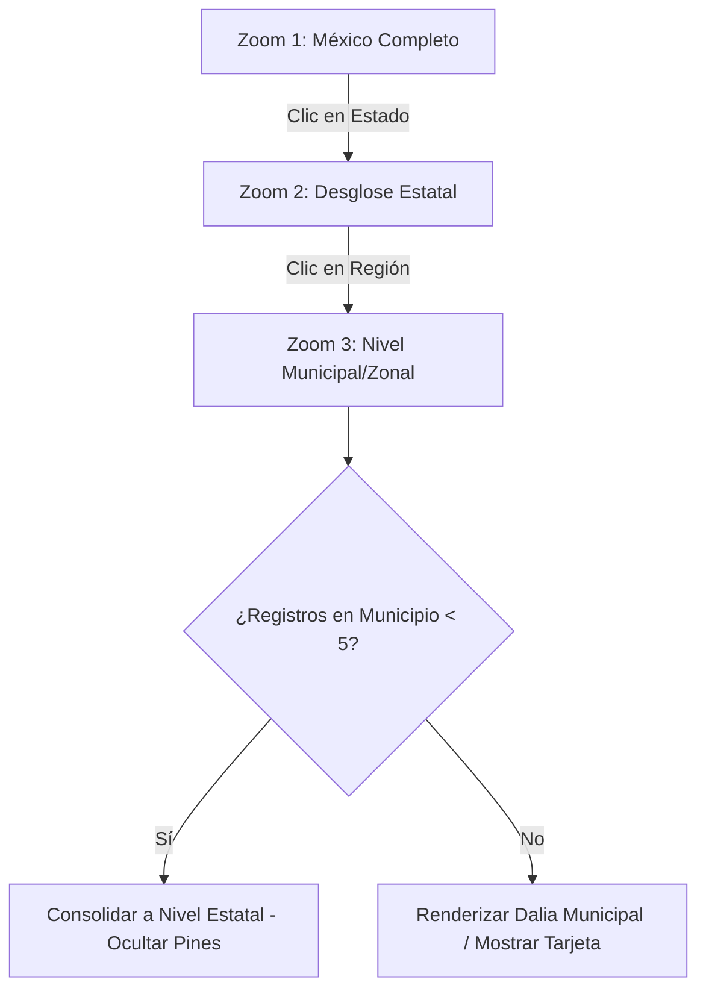
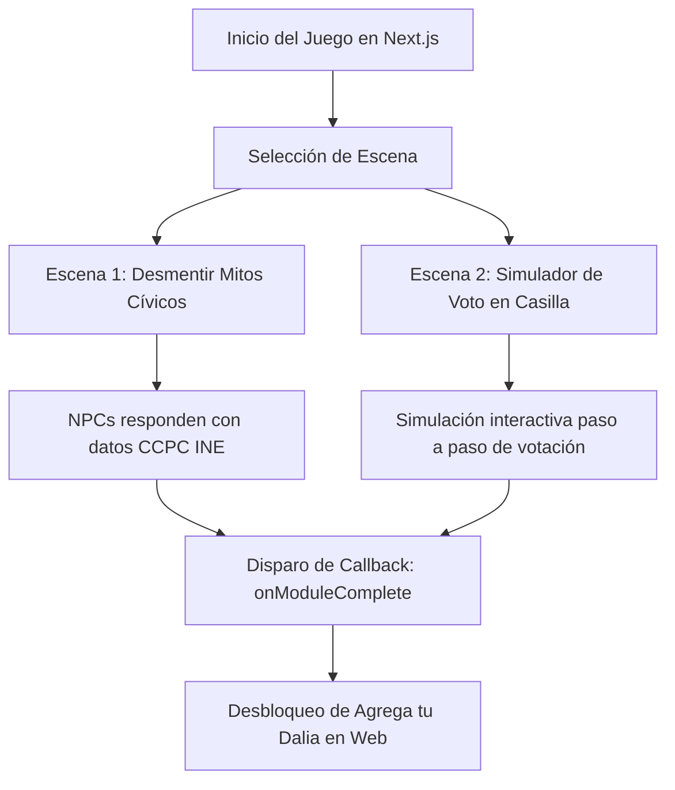

# Plan de Desarrollo Detallado por Sprints — Mapa de Dalias y Participación Ciudadana (Hackathon INE)

Este documento contiene la hoja de ruta técnica completa para el equipo de desarrollo de **Mapa de Dalias y Participación Ciudadana** (Reto 3 del Hackathon INE).

> [!IMPORTANT]
> **Prioridad Máxima del Proyecto:** El **Mapa de Dalias** (gancho de prueba social) y el **Modo Juego Pixel Art** (narrativa gamificada para jóvenes) son el núcleo y diferenciador principal de la plataforma. El **Asistente de IA** se desplaza al Sprint 4 como módulo final de pulido.

---

## 📌 Información General

- **Reto:** Reto 3 — Comunicación y visualización con impacto público (Hackathon INE)
- **Duración Total:** 3 Semanas (Divididas en 4 Sprints iterativos)
- **Equipo:** 4 Desarrolladores (Next.js, FastAPI, PostgreSQL, PixiJS)
- **Repositorio:** [`Betto-RZE/sadaPops`](https://github.com/Betto-RZE/sadaPops.git)

---

## 🏗️ Asignación de Roles en el Equipo (4 Desarrolladores)



- **Dev 1 (Lead del Mapa de Dalias):** Responsable de la construcción del motor SVG de dalias (`react-simple-maps`, `d3-geo`, `d3-scale`), zoom niveles 1 a 3, animaciones de pétalos, umbral de privacidad en frontend y la vista de tabla alternativa para lectores de pantalla.
- **Dev 4 (Lead del Juego Pixel Art):** Responsable del motor 2D en `packages/game` (PixiJS/Kaplay), diseño de escenas de Mitos y Simulador de Voto, spritesheets, integración dinámica con Next.js (`ssr: false`) y evento de desbloqueo.
- **Dev 2 (UI/UX, Storytelling & Dashboard):** Responsable de la interfaz web, componentes shadcn/ui, secuencia narrativa, selector de preguntas del Dashboard CCPC, soporte bilingüe (Español/Náhuatl) y enlaces oficiales INE.
- **Dev 3 (Backend & Data Engineer):** Responsable de la API FastAPI, modelos SQLAlchemy, migraciones Alembic, script ETL offline `ccpc_ingest.py`, endpoints del Mapa y Dashboard, y despliegue del backend.

---

## 🔍 ESPECIFICACIÓN DETALLADA: MAPA DE DALIAS (CORE #1)

El Mapa de Dalias es el gancho visual y prueba social de la plataforma. Convierte la participación cívica en una metáfora floral donde cada dalia representa a una persona que decidió informarse.



### 1. Nivel de Zoom 1 (Nacional — México Completo)
- **GeoJSON:** `public/geojson/mexico_estados.json` (INEGI).
- **Proyección Map:** `geoMercator` con centroide en `[-102.5528, 23.6345]` y escala inicial `1000`.
- **Renderizado de Dalia:** 1 dalia SVG por estado con registros activos. El radio del florón se calcula dinámicamente con la función de raíz cuadrada de d3:
  `r = d3.scaleSqrt(registros_estado, [16, 52])`
- **Animación SVG:** Pétalos concéntricos generados dinámicamente según el volumen. Los estados con 0 registros no muestran dalia.
- **Interacción:** Al hacer hover, se activa un tooltip con la cuenta total. Al hacer clic en un estado, se dispara la transición de cámara (`framer-motion` / `d3-zoom`) enfocando el centroide del estado con escala `2400`.

### 2. Nivel de Zoom 2 (Desglose Estatal)
- **Comportamiento Visual:** La dalia grande del estado se descompone suavemente en un racimo de dalias regionales.
- **GeoJSON:** `public/geojson/mexico_municipios.json` filtrado por `cve_ent` del estado activo.
- **Información Agregada:** Tarjeta de resumen estatal ("Puebla: 4,821 personas informadas").

### 3. Nivel de Zoom 3 (Municipal / Zonal)
- **Mecanismo Anti-Reidentificación (N=5):**
  - Si un municipio tiene `registros < 5` dalias registradas, el backend envía `is_aggregated_to_state: true`.
  - El frontend **no renderiza pines individuales** para ese municipio y suma la cantidad al acumulado del Zoom 2.
  - Se muestra una nota informativa: *"Datos consolidados a nivel estatal para garantizar el anonimato de la comunidad"*.
- **Tarjeta de Dalia (`DaliaCard`):** Al hacer clic en una dalia municipal (con `registros >= 5`), se abre un modal sin PII:
  - Muestra el módulo consultado (ej. "Completó: Dashboard CCPC").
  - Muestra un timestamp relativo anónimo (ej. "Hace 2 horas").
  - **Cero campos de texto libre o nicknames** para evitar desinformación o vandalismo.

### 4. Alternativa Accesible WCAG 2.1 AA
- Botón fijado sobre el mapa: **"Ver en formato de tabla accesible"**.
- Carga el componente `<TablaAccesibleDalias />` con marcado semántico `<table>`, encabezados `<th>`, resumen `<caption>` y navegación 100% por teclado.

---

## 🎮 ESPECIFICACIÓN DETALLADA: MODO JUEGO PIXEL ART (CORE #2)

El Modo Juego Pixel Art vive en el paquete `@mapa-dalias/game` (`packages/game/`). Proporciona una vía narrativa gamificada pensada para el público joven.



### 1. Arquitectura del Motor (`packages/game/`)
- **Librería Engine:** PixiJS v7 o Kaplay.js en TypeScript.
- **Renderizado Canvas:** Canvas 2D responsive ($800 \times 450$ px base, ajustado con CSS estirable sin distorsión de píxeles).
- **Spritesheets:** Personaje de funcionario del INE en pixel art, urnas de votación, boletas electorales, mamparas y ciudadanía diversa (representación respetuosa de regiones rurales, urbanas, indígenas y migrantes).

### 2. Escena 1: Desmentir Mitos (Diálogos con Datos CCPC)
- **Entorno:** Mapa 2D de un módulo cívico del INE en pixel art.
- **Mecánica:** El jugador se desplaza con teclado/touch e interactúa con personajes jóvenes que plantean dudas electorales (ej. *"¿Para qué votar si a los jóvenes no nos toman en cuenta?"*).
- **Grafo de Diálogo:** El jugador selecciona entre 3 opciones de respuesta. La respuesta correcta utiliza **datos oficiales procesados de la CCPC del INE** (ej. *"De 2012 a 2024 la participación del grupo de 18-29 años creció en 14 entidades"*).
- **Premio:** Al desmentir un mito correctamente, se otorga una medalla cívica en el juego.

### 3. Escena 2: Simulador de Voto (Emulador de Casilla Electoral)
- **Objetivo Educativo:** Familiarizar a votantes primerizos con el proceso real de votación para reducir la ansiedad del día de la elección.
- **Paso a Paso Jugable:**
  1. **Llegada a Casilla:** Presentación de la credencial del INE al funcionario de mesa.
  2. **Lista Nominal:** Verificación en la lista nominal oficial.
  3. **Entrega de Boletas:** Recepción de boletas impresas para la elección.
  4. **Mampara Secreta:** Entrar a la mampara y marcar el voto de forma secreta.
  5. **Depósito en Urnas:** Depositar cada boleta en la urna correspondiente según la elección.
  6. **Tinta Indeleble:** Aplicación de tinta indeleble en el pulgar derecho y devolución de la credencial.

### 4. Integración Dinámica y Desbloqueo en Next.js
- En `apps/web/src/features/juego/GameLoader.tsx`:
  ```tsx
  const CanvasGame = dynamic(() => import('@mapa-dalias/game'), { 
    ssr: false, 
    loading: () => <div className="game-loader">Cargando motor de juego pixel art...</div> 
  });
  ```
- Al finalizar cualquiera de las dos escenas, el motor dispara el evento `onModuleComplete('juego')`.
- La aplicación web procesa el evento y **desbloquea de inmediato** el botón "Agrega tu dalia" en la interfaz principal.

---

## 🚀 Hoja de Ruta Actualizada por Sprints

### 🟢 Sprint 1: Infrastructure, Docker & Ingesta ETL CCPC (Días 1 - 5)
- **Dev 3 (Backend & DB):** FastAPI base, `backend/Dockerfile`, `entrypoint.sh` automatizado, modelos SQLAlchemy e ingesta offline de la CCPC (`ccpc_ingest.py`).
- **Dev 1 & Dev 2 (Frontend):** Monorepo setup (`pnpm-workspace.yaml`, `package.json`), Next.js 14 App Router, Tailwind CSS, shadcn/ui y `packages/types`.
- **Dev 4 (Game Engine Setup):** Setup del paquete `packages/game` con Vite y PixiJS/Kaplay.
- **Entregable:** Contenedores `postgres` y `backend` corriendo con un solo comando (`docker compose up -d`) y datos de la CCPC cargados en la BD.

---

### 🌸 Sprint 2: ENFOQUE TOTAL EN EL MAPA DE DALIAS (Zoom 1-3) & NARRATIVA (Días 6 - 11)
- **Dev 1 (Lead Mapa Dalias):**
  - Cargar GeoJSONs del INEGI en `apps/web/public/geojson/`.
  - Desarrollar `NationalMap`, `StateMap` y `MunicipalMap` con `react-simple-maps` y `d3-geo`.
  - Aplicar algoritmo de escalado de raíz cuadrada `d3.scaleSqrt` para el tamaño dinámico de las dalias.
  - Desarrollar el componente alternativo `<TablaAccesibleDalias />` (WCAG 2.1 AA).
- **Dev 3 (Backend Endpoints Mapa):**
  - Crear endpoint `GET /api/v1/dalias/aggregate`.
  - Aplicar la regla del umbral N=5 para municipios pequeños.
- **Dev 2 (Narrativa & Desbloqueo):**
  - Desarrollar la secuencia de Narrativa (problemas $\to$ mecanismo $\to$ reflexión $\to$ electores foráneos).
  - Implementar hook `useSesionAnonima` y sistema de desbloqueo condicionado de registro.
- **Dev 4 (UI del Mapa):**
  - Construir modal emergente `DaliaCard` (sin PII, timestamps relativos).
- **Entregable:** Mapa SVG de México completamente interactivo con 3 niveles de zoom, dalias dinámicas, umbral de privacidad activo y vista accesible para lectores de pantalla.

---

### 🎮 Sprint 3: ENFOQUE TOTAL EN EL MODO JUEGO PIXEL ART & DASHBOARD CCPC (Días 12 - 16)
- **Dev 4 (Lead Juego Pixel Art):**
  - Desarrollar Escena 1 "Desmentir Mitos" con grafo de diálogo y datos CCPC.
  - Desarrollar Escena 2 "Simulador de Voto" paso a paso.
  - Montar el wrapper `GameLoader.tsx` con `ssr: false` y callback `onModuleComplete`.
- **Dev 2 (Dashboard CCPC & Preguntas):**
  - Interfaz del selector de 4 preguntas cívicas en `features/dashboard-ccpc/`.
  - Tarjetas de frases contextuales cortas (1-2 oraciones).
  - Sección de enlaces a Herramientas Oficiales INE (casillas, observadores, foráneos).
- **Dev 1 (Gráficas Dinámicas Dashboard):**
  - Ruteador de gráficas dinámicas (Barras Recharts, Líneas Visx, Mapas de calor).
- **Dev 3 (Backend Dashboard Queries):**
  - Endpoints `/api/v1/dashboard/preguntas/{id}` formateando datos de la CCPC.
- **Entregable:** Juego en Pixel Art 100% playable en Next.js con simulador de voto + Dashboard de datos CCPC con gráficas interactivas.

---

### 🤖 Sprint 4: Pulido Final, Asistente de IA, Auditoría WCAG AA & Despliegue (Días 17 - 21)
- **Dev 4 & Dev 3 (Asistente de IA - Módulo Final):**
  - Endpoint `POST /api/v1/asistente/chat` en FastAPI con System Prompt acotado estrictamente a datos de la CCPC.
  - Widget flotante `features/asistente-ia/` en la esquina inferior derecha.
- **Dev 2 (Multilenguaje & Auditoría):**
  - Diccionarios i18n (`src/i18n/es.json` y `src/i18n/nah.json`).
  - Auditoría de accesibilidad con `axe-cli` (navegación por teclado, contraste WCAG AA).
- **Dev 1 & Dev 3 (Despliegue a Producción):**
  - Despliegue en Neon PostgreSQL, Google Cloud Run (Backend) y Vercel (Frontend + Juego).
- **Entregable:** Plataforma completa en producción con Mapa, Juego, Dashboard, Asistente IA opcional, accesibilidad verificada y multilenguaje en Náhuatl.

---

## 🧪 Matriz de Verificación y Control de Calidad

| Sprint | Comandos de Verificación | Criterio de Aceptación Exigido |
|---|---|---|
| **Sprint 1** | `docker compose up -d` & `pytest backend/tests/` | Backend responde `/health` 200 OK y tablas CCPC pobladas en PostgreSQL. |
| **Sprint 2** | `pnpm --filter web dev` & Pruebas manuales Zoom 1-3 | Mapa SVG rinde dalias dinámicas, umbral N < 5 activo y tabla accesible funciona. |
| **Sprint 3** | `pnpm --filter web dev` en `/juego` y `/dashboard` | Juego corre a 60 fps sin errores SSR y Dashboard rinde gráficas por preguntas. |
| **Sprint 4** | `npx axe-cli http://localhost:3000` & `pnpm build` | Build limpio de producción y 0 errores críticos de accesibilidad WCAG AA. |
