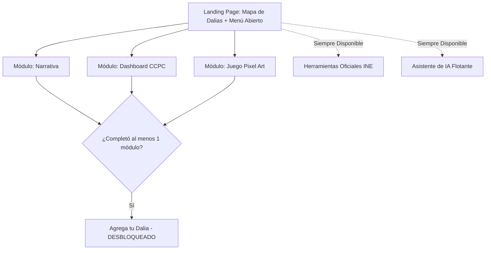

# PROJECT_CONTEXT.md — Contexto Técnico y de Dominio

## 1. Contexto del Hackathon y Resumen del Reto

- **Hackathon:** Hackathon INE (Instituto Nacional Electoral)
- **Reto:** Reto 3 — Comunicación y visualización con impacto público
- **Nombre del Proyecto:** Mapa de Dalias y Participación Ciudadana
- **Público Objetivo Primario:** Jóvenes
- **Público Objetivo Secundario:** Público general interesado en la participación cívica y electoral

---

## 2. Propuesta de Valor y Diferenciadores Clave

La mayoría de las soluciones para la concientización cívica se enfocan en infografías estáticas o mensajes emocionales ("por qué votar importa"). Este proyecto se diferencia mediante cuatro pilares fundamentales:

1. **Prueba Social Visible (Mapa de Dalias):** Utiliza la dalia (flor nacional de México) como representación visual de la concientización cívica individual. Mostrar que "otros como tú ya se están informando" aprovecha la motivación entre pares sin exponer identidades personales.
2. **Puentes Intermedios Accionables:** Conecta directamente el deseo de participar con los siguientes pasos concretos (enlaces oficiales a la ubicación de casillas del INE, registro de observadores y voto foráneo).
3. **Traducción de la CCPC Orientada a Preguntas:** Convierte datos complejos de la CCPC del INE (archivos .zip por año) en visualizaciones intuitivas guiadas por preguntas de interés social (ej. *"¿Por qué mi estado vota tan poco?"*), combinadas con selección dinámica de gráficas (barras, líneas, mapas de calor).
4. **Modo Juego Pixel Art Complementario:** Proporciona un canal narrativo alternativo adecuado para jóvenes a través de un juego interactivo en pixel art con un emulador de votación y desafíos para desmentir mitos.

---

## 3. Arquitectura de Navegación y Flujo de UX

### Modelo de Acceso Libre con Registro Condicionado
Todos los módulos de contenido están desbloqueados y accesibles desde la página de inicio desde el primer segundo. La acción de registro ("Agrega tu dalia") está bloqueada con un distintivo visual hasta que el usuario completa **al menos uno** de los tres módulos principales de contenido.

### Criterios de Finalización de Módulos
- **Narrativa:** El usuario llega a la sección final de reflexión (incluye el contexto de electores foráneos).
- **Dashboard CCPC:** El usuario explora al menos 1 pregunta completa (dato + gráfica dinámica + frase de contexto).
- **Modo Juego:** El usuario completa 1 escena completa (1 mito desmentido o 1 ciclo del simulador de voto).

---

## 4. Especificaciones de Funcionalidades

### 4.1. Mapa de Dalias (Motor de Mapa Interactivo)
- **Nivel de Zoom 1 (Nacional):** 1 dalia por estado con registros activos. El tamaño de la dalia escala dinámicamente según el conteo acumulado. Los estados sin registros no muestran dalia.
- **Nivel de Zoom 2 (Desglose Estatal):** La dalia estatal principal se descompone en dalias regionales.
- **Nivel de Zoom 3 (Municipal / Zonal):** Dalias individuales o agrupadas ubicadas por zona aproximada.
- **Interacción:** Al hacer clic en una dalia se muestra una tarjeta agregada (temas consultados, timestamp anónimo). No se permiten datos personales, nicknames ni texto libre.
- **Umbral de Privacidad:** Si un municipio tiene $< 5$ registros, se agrega automáticamente al nivel estatal para prevenir la re-identificación en comunidades pequeñas.

### 4.2. Dashboard CCPC (Motor de Datos Orientado a Preguntas)
- **Selector de Preguntas:** El punto de entrada presenta preguntas de interés social:
  - *"¿Por qué mi estado vota tan poco?"*
  - *"¿Quién participa más, hombres o mujeres?"*
  - *"¿Los jóvenes realmente votan menos que mis papás?"*
  - *"¿Ha cambiado la participación con los años?"*
- **Visualización Dinámica:** Tipo de gráfica seleccionado según la estructura de los datos:
  - *Comparación categórica:* Gráfica de barras (Recharts)
  - *Tendencias temporales:* Gráfica de líneas (Visx/Recharts)
  - *Comparación geográfica:* Mapa de calor / Mapa coroplético
- **Contexto Corto:** 1 o 2 frases concisas de contexto que acompañan cada respuesta gráfica.

### 4.3. Modo Juego Pixel Art
- **Integración Técnica:** Construido en `packages/game` con PixiJS/Kaplay. Cargado dinámicamente en Next.js con `ssr: false`.
- **Rol 1 (Desmentir Mitos):** Sprite de funcionario del INE responde mitos electorales comunes respaldados con datos de la CCPC.
- **Rol 2 (Simulador de Voto):** Emulador interactivo paso a paso del proceso de votación en una casilla.
- **Respeto Cultural e Inclusión:** Los sprites de los personajes representan la diversidad regional (rural, urbana, indígena, migrante). Los diseños deben evitar estereotipos y caricaturas.

### 4.4. Asistente de IA (Chatbot Cívico)
- **Alcance:** Endpoint en el backend de FastAPI conectado a la API de LLM.
- **Restricción:** Contexto strictly limitado a las tablas procesadas de la CCPC + texto editorial de la plataforma. Rechaza debate político abierto o declaraciones no verificadas.
- **Idiomas:** Soporte dual para Español y Náhuatl.

### 4.5. Herramientas Oficiales INE (Sección de Enlaces)
Enlaces directos y contextuales a plataformas oficiales del INE:
- Ubicador de Casillas (incluyendo electores foráneos / voto fuera de su sección)
- Registro de Observadores Electorales (Art. 217 LGIPE)
- Convocatoria de Funcionariado de Casilla

---

## 5. Resumen del Stack Técnico

| Dominio | Tecnología | Justificación |
|---|---|---|
| Frontend Web | Next.js 14+ (App Router), TS, Tailwind CSS | Rápido, accesible, capaz de SSR/SSG |
| Componentes UI | shadcn/ui, Radix UI | Cumplimiento ARIA listo para usar |
| Motor de Mapas | react-simple-maps, d3-geo, GeoJSON INEGI | Control suave de zoom SVG 1-3 sin APIs de pago |
| Motor de Gráficas | Recharts / Visx | Tipos de gráficas dinámicas adaptadas por dataset |
| Motor del Juego | PixiJS / Kaplay (en `packages/game`) | Canvas 2D ligero, único build en monorepo |
| API Backend | FastAPI (Python 3.11+) | Rendimiento asíncrono, validación Pydantic |
| Base de Datos | PostgreSQL (Neon / Docker Compose) | Almacenamiento relacional para conteos y CCPC |
| Pipeline de Datos | Python ETL (`etl/ccpc_ingest.py`) | Parseo offline de archivos ZIP oficiales CCPC INE |
| Infra/Dev | Docker Compose | Entorno local de un solo comando |

---

## 6. Restricciones Éticas, de Privacidad y Accesibilidad

1. **Anonimato Estricto:** Cero cuentas, cero formularios de inicio de sesión, cero campos de comentarios en texto libre.
2. **Protección contra Re-identificación:** Umbral mínimo de agregación ($N=5$) para mapas municipales.
3. **Accesibilidad (WCAG 2.1 AA):**
   - Navegación completa por teclado.
   - Vista alternativa de tabla narrativa accesible para usuarios de lectores de pantalla.
   - Paletas aptas para daltonismo (nunca depender únicamente del color para transmitir datos).
   - Soporte i18n para Náhuatl.
