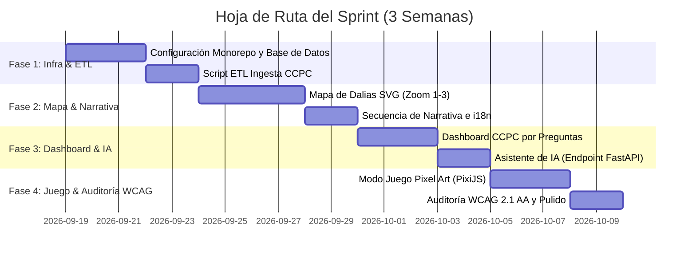

# WORKFLOW.md — Hoja de Ruta de Ejecución del MVP a 3 Semanas (Hackathon INE)

Esta hoja de ruta detalla el plan de ejecución paso a paso para construir y entregar **Mapa de Dalias y Participación Ciudadana** dentro de un sprint de 3 semanas.

---

## Visión General del Sprint e Hitos



---

## Fase 1: Infraestructura, Monorepo e Ingesta (Días 1 - 5)

### Objetivos
- Inicializar el monorepo con pnpm (`apps/web`, `packages/game`, `packages/types`, `backend`).
- Configurar Docker Compose con PostgreSQL y FastAPI.
- Ejecutar el script ETL offline `ccpc_ingest.py` para parsear el archivo ZIP de la CCPC del INE e insertar los datos en tablas SQL limpias.

### Lista de Tareas
- [ ] Inicializar `pnpm-workspace.yaml` y `turbo.json`.
- [ ] Crear proyecto Next.js 14 App Router en `apps/web` con Tailwind CSS y shadcn/ui.
- [ ] Crear app de FastAPI en `backend` con conexión asíncrona de SQLAlchemy a Postgres.
- [ ] Implementar `backend/etl/ccpc_ingest.py` y verificar las tablas `ccpc_participacion_estado` y `ccpc_participacion_edad`.
- [ ] Configurar `packages/types` para contratos TypeScript compartidos.

### Comandos de Verificación
```bash
# Verificar infraestructura local
docker compose up -d

# Verificar conexión a base de datos y migraciones en backend
cd backend && pytest tests/test_db_connection.py

# Verificar resultados de la ingesta ETL
python etl/ccpc_ingest.py --file ../data/raw/ccpc_ine_official.zip
```

---

## Fase 2: Motor del Mapa de Dalias, Holograma Voxel 3D y Experiencia Visual (Días 6 - 11)

### Objetivos
- Construir el mapa interactivo de México con estética pixel art / isométrica y proyección holográfica 3D.
- Integrar siluetas voxel amplificadas de los 32 estados de la República Mexicana.
- Implementar la card HUD de participación estatal con datos oficiales de participación juvenil INE 2024.
- Normalizar nombres oficiales directos en hover y mapa (Veracruz, Coahuila, Michoacán, Estado de México).
- Calibrar la física de caída y planeo natural de pétalos flotantes en el Hero.

### Estado de Tareas
- [x] Motor volumétrico de mapa en canvas con bisel y elevación (`PixelMap.tsx`).
- [x] Siluetas voxel 3D de los 32 estados horneadas con paleta índigo oficial (`/data/holo/state-*.png`).
- [x] Cono de proyección simétrico de alta precisión sin costo de blur en GPU.
- [x] Chasis voxel 3D con bisel escalonado, canal hundido y botón cápsula voxel (`StateHologramCard.tsx`).
- [x] Tipografía sans serif moderna en dos niveles (`CIUDAD DE` / `MÉXICO`) con `Plus Jakarta Sans` y escalado dinámico.
- [x] Indicador de participación juvenil INE 2024 con icono vectorial `BarChart` cian luminoso.
- [x] Contador voxel 3D con atlas numérico recortado de alta definición (`numerosV2`).
- [x] Desfases dinámicos calibrados para CDMX (`09`) y Puebla (`21`).
- [x] Normalización de nombres de estado oficiales en hover y mapa.
- [x] Copy actualizado: *"personas que ya dieron el primer paso"*.
- [x] Caída de pétalos con planeo y deriva natural sin bloqueos ni doble freno (`FloatingPetals.tsx`).
- [x] **Calibración de tamaños de dalias:**\r\n  - Ajuste de jerarquía y proporciones de escala en DahliaLayer (computeLevels.ts, tamaños por nivel 1 a 4).\r\n  - Balance visual para estados de alta y baja densidad geográfica con factor 0.80x para micro-estados.\r\n  - Recolocación óptica de Puebla () e Hidalgo () hacia Veracruz.\r\n- [x] **Optimización y funcionamiento mobile (< 768px):**\r\n  - Layout editorial responsivo: titular compacto y nítido arriba, mapa protagonista limpio sobre fondo pergamino abajo.\r\n  - Posicionamiento y escalado adaptativo de la card holográfica en pantallas pequeñas (< 768px), sin desborde.\r\n  - Botón accesible de cierre táctil ✕ (WCAG 2.1 AA) en el chasis de la tarjeta.\r\n  - Interacciones táctiles mejoradas: diferenciador tap vs scroll (prevención de secuestro de scroll al deslizar la página).\r\n  - Hitbox asistido ampliado en micro-estados para toques con el pulgar.\r\n  - Rendimiento a 60 FPS garantizado: supresión de brisa pointermove en pantallas táctiles y optimización de pétalos perimetrales.\r\n\r\n### Comandos de Verificación
```bash
# Verificar infraestructura local
docker compose up -d

# Verificar conexión a base de datos y migraciones en backend
cd backend && pytest tests/test_db_connection.py

# Verificar resultados de la ingesta ETL
python etl/ccpc_ingest.py --file ../data/raw/ccpc_ine_official.zip
```

---

## Fase 2: Motor del Mapa de Dalias, Holograma Voxel 3D y Experiencia Visual (Días 6 - 11)

### Objetivos
- Construir el mapa interactivo de México con estética pixel art / isométrica y proyección holográfica 3D.
- Integrar siluetas voxel amplificadas de los 32 estados de la República Mexicana.
- Implementar la card HUD de participación estatal con datos oficiales de participación juvenil INE 2024.
- Normalizar nombres oficiales directos en hover y mapa (Veracruz, Coahuila, Michoacán, Estado de México).
- Calibrar la física de caída y planeo natural de pétalos flotantes en el Hero.

### Estado de Tareas
- [x] Motor volumétrico de mapa en canvas con bisel y elevación (`PixelMap.tsx`).
- [x] Siluetas voxel 3D de los 32 estados horneadas con paleta índigo oficial (`/data/holo/state-*.png`).
- [x] Cono de proyección simétrico de alta precisión sin costo de blur en GPU.
- [x] Chasis voxel 3D con bisel escalonado, canal hundido y botón cápsula voxel (`StateHologramCard.tsx`).
- [x] Tipografía sans serif moderna en dos niveles (`CIUDAD DE` / `MÉXICO`) con `Plus Jakarta Sans` y escalado dinámico.
- [x] Indicador de participación juvenil INE 2024 con icono vectorial `BarChart` cian luminoso.
- [x] Contador voxel 3D con atlas numérico recortado de alta definición (`numerosV2`).
- [x] Desfases dinámicos calibrados para CDMX (`09`) y Puebla (`21`).
- [x] Normalización de nombres de estado oficiales en hover y mapa.
- [x] Copy actualizado: *"personas que ya dieron el primer paso"*.
- [x] Caída de pétalos con planeo y deriva natural sin bloqueos ni doble freno (`FloatingPetals.tsx`).
- [ ] **Próxima sesión — Calibración de tamaños de dalias:**
  - Ajuste de jerarquía y proporciones de escala en `DahliaLayer` (`computeLevels.ts`, tamaños por nivel 1 a 4).
  - Balance visual para estados de alta y baja densidad geográfica.
- [ ] **Próxima sesión — Optimización y funcionamiento mobile:**
  - Posicionamiento y escalado adaptativo de la card holográfica en pantallas pequeñas (< 768px).
  - Interacciones táctiles (`touch-manipulation`), tap targets y prevención de zooms accidentales.
  - Comportamiento responsive de la capa de pétalos y siluetas en viewports móviles.

### Comandos de Verificación
```bash
# Ejecutar servidor de desarrollo web
pnpm --filter web dev

# Probar endpoints de la API de Dalias
cd backend && pytest tests/features/test_dalias.py
```

---

## Fase 3: Dashboard CCPC y Asistente de IA Acotado (Días 12 - 16)

### Objetivos
- Construir el Dashboard de la CCPC orientado a preguntas (`features/dashboard-ccpc`).
- Implementar selector de gráficas dinámicas (barras Recharts, líneas, mapa de calor).
- Construir el widget flotante del asistente de IA y su endpoint en FastAPI.
- Integrar puentes a herramientas oficiales del INE (casillas, observadores, foráneos).

### Lista de Tareas
- [ ] Implementar interfaz del selector de preguntas con las 4 preguntas cívicas principales.
- [ ] Crear componentes de gráficas dinámicas (BarChart, TimeLineChart, HeatMapChart).
- [ ] Construir endpoint `POST /api/v1/asistente/chat` en FastAPI con acotamiento de contexto.
- [ ] Construir widget de chat `features/asistente-ia` con soporte para Markdown.
- [ ] Agregar tarjetas de enlaces en `features/herramientas-oficiales`.

### Comandos de Verificación
```bash
# Probar consultas de la API del Dashboard
cd backend && pytest tests/features/test_dashboard.py

# Probar límite de dominio del Asistente de IA
cd backend && pytest tests/features/test_asistente.py
```

---

## Fase 4: Juego Pixel Art, Auditoría WCAG y Pulido Final (Días 17 - 21)

### Objetivos
- Construir escenas del juego en PixiJS/Kaplay en `packages/game` (Desmentir mitos y Simulador de voto).
- Cargar el juego en Next.js mediante importación dinámica con `ssr: false` (`GameLoader.tsx`).
- Realizar auditoría de accesibilidad WCAG 2.1 AA (navegación por teclado, alto contraste, vista de tabla accesible narrada).
- Agregar soporte i18n para Náhuatl (`src/i18n/nah.json`).

### Lista de Tareas
- [ ] Implementar el motor PixiJS y hojas de sprites en `packages/game`.
- [ ] Montar el juego en `apps/web/src/features/juego/GameLoader.tsx`.
- [ ] Implementar fallback para lector de pantalla `<TablaAccesibleDalias />`.
- [ ] Agregar selector de idioma Náhuatl y actualizar diccionarios.
- [ ] Ejecutar prueba de flujo de usuario de principio a fin y preparar documentación de presentación.

### Comandos de Verificación
```bash
# Compilar el monorepo completo para producción
pnpm build

# Ejecutar herramienta de auditoría de accesibilidad
npx axe-cli http://localhost:3000
```
