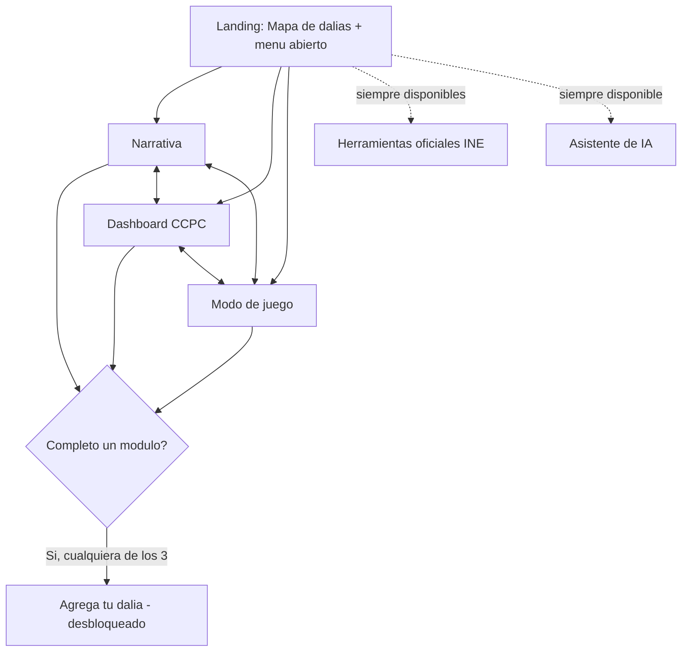

# Propuesta — Mapa de Dalias y Participación Ciudadana

**Reto 3: Comunicación y visualización con impacto público (Hackathon INE)**

## 1. Resumen ejecutivo

Plataforma digital cuyo punto de entrada es un mapa interactivo de México representado con dalias (flores) como unidad visual de participación: cada dalia representa a una persona que decidió informarse sobre participación ciudadana. El mapa funciona como gancho visual y prueba social de que existe una comunidad creciente interesada en el tema.

A partir de ahí, la experiencia guía al usuario por una secuencia narrativa (problemas actuales → por qué importa votar → reflexión sobre persuasión vs. preparación → registro para acción concreta), incluye un dashboard de apoyo (no el núcleo de la app) que traduce los datos de la CCPC del INE mediante preguntas de interés social e interactividad, ofrece un modo de juego complementario en pixel art para consumo narrativo alternativo, y ofrece un asistente de IA para resolver dudas puntuales.

Público objetivo primario: jóvenes. Público secundario: cualquier persona interesada en participación ciudadana.

## 2. El diferenciador

La mayoría de propuestas para este reto probablemente serán infografías o carruseles estáticos que explican "por qué votar importa". Esta propuesta se diferencia en cuatro puntos:

**Prueba social visible:** el mapa de dalias no es decoración — es un mecanismo de movilización con respaldo conceptual: hacer visible que "otros como tú ya están participando/informándose" es un efecto de presión/prueba social documentado en estudios de movilización electoral. El mapa traduce ese principio a una experiencia amigable, sin exhibir a nadie individualmente.

**Puentes intermedios reales, no solo mensaje emocional:** la plataforma conecta el "quiero participar" con acciones concretas (registro, notificaciones, oportunidades de colaborar), resolviendo la falla diagnosticada en campañas anteriores (ej. #HablemosDeLoQueImporta) que se quedaron solo en la difusión del mensaje sin dar el siguiente paso accionable.

**Traducción real de la CCPC, orientada a preguntas:** el dashboard convierte una fuente de datos robusta pero técnica e institucional (requiere manual, entrega .zip por año) en algo que se entiende en minutos — partiendo de una pregunta de interés social ("¿por qué mi estado tiene tan poca participación?"), no de una gráfica sin contexto, que es el error habitual que hace ilegibles a muchos portales de datos de gobierno.

**Modo de juego complementario para consumo narrativo alternativo:** dado que el público primario es joven, la plataforma ofrece, además del dashboard basado en preguntas, un modo de juego en pixel art que aborda mitos sobre participación electoral y simula el proceso de votar — una vía de entrada más dinámica a la misma narrativa, sin sustituir la precisión de los datos.

## 3. Estructura de la experiencia — flujo de navegación

**Modelo elegido: acceso libre desde el inicio, con registro condicionado.** Narrativa, dashboard y juego están abiertos desde el primer momento, en el orden que el usuario prefiera — no hay ningún tramo obligatorio de contenido. Lo único condicionado es el registro ("agregar tu dalia"): se desbloquea al completar **cualquiera** de los tres módulos (uno basta, no los tres), preservando la idea de que la dalia representa a alguien que se informó, sin forzar un recorrido lineal para llegar ahí.

**Paso 1 — Landing.**
Mapa de dalias (Zoom 1, México completo) — gancho visual y prueba social, sin login. Junto al mapa, el menú de navegación fija ya está visible **desde el primer segundo**, con Narrativa, Dashboard, Juego, Herramientas oficiales del INE y Asistente de IA disponibles de inmediato. "Agrega tu dalia" está visible pero bloqueado (candado + texto breve: "descubre algo primero para desbloquearlo").

**Paso 2 — Exploración libre, sin orden impuesto.**
El usuario entra al módulo que prefiera:
- **Narrativa** — internamente sigue siendo secuencial dentro de sí misma: problemas actuales → mecanismo (por qué importa votar) → reflexión (persuasión vs. preparación, incluye el caso de electores foráneos — sección 6).
- **Dashboard CCPC** — preguntas de interés social (sección 5).
- **Modo de juego** — mitos + simulador de participación, en pixel art (sección 5-bis).

**Paso 3 — Desbloqueo de registro.**
Al completar cualquiera de los tres módulos anteriores, se desbloquea "Agrega tu dalia" con un CTA visible. Criterio mínimo de "completar" por módulo, para que el umbral sea consistente y no trivial de saltar:
- *Narrativa:* llegar al final de la reflexión.
- *Dashboard:* haber consultado al menos una pregunta completa (dato + gráfica).
- *Juego:* haber jugado al menos una escena completa (un mito respondido o el simulador completado una vez).

**Utilitarios siempre abiertos (no cuentan para el desbloqueo del registro):**
- **Herramientas oficiales del INE** — ubicador de casillas (incluye foráneos), observadores/funcionariado de casilla (sección 6). Son enlaces de apoyo, no contenido informativo propio.
- **Asistente de IA** — flotante y persistente en toda la app desde el landing (sección 7).



Esta estructura reemplaza cualquier tramo lineal obligatorio: los tres módulos de contenido (narrativa, dashboard, juego) son igualmente accesibles desde el landing, y solo el registro tiene una condición — haber consumido al menos uno de ellos por completo.

## 4. Mapa de dalias — mecánica

**Zoom 1 (México completo):** una dalia por estado con registros; el tamaño representa la cantidad de registros. Estados sin registros no muestran dalia.

**Zoom 2 (estado):** la dalia grande se descompone progresivamente en varias dalias, representando el paso de "comunidad agregada" a "personas".

**Zoom 3 (municipio/zona):** cada dalia representa un registro individual, ubicado por zona aproximada — sin revelar ubicación exacta ni datos personales.

**Interacción:** al hacer clic en una dalia individual, se muestra una tarjeta con información agregada (qué tipo de contenido se consultó, sin identificar a la persona) — nunca información política personal ni evidencia de que esa persona votó (el registro indica que se informó, no que votó).

**Anonimato por diseño:** las dalias son completamente anónimas y no incluyen texto libre ni nickname. No hay campo de captura abierta que un usuario pueda llenar con contenido partidista, ofensivo o desinformación. Si se desea mantener un componente de "voz" de la comunidad, se puede ofrecer una lista cerrada de frases predefinidas y neutrales que el usuario elige (nunca redacta), pero el diseño por defecto no depende de esto.

**Estética:** predominantemente morada, limpia y moderna; se evita que la metáfora floral se sienta infantil o sobre-gamificada.

## 5. Dashboard CCPC — diseño orientado a preguntas (apoyo, no el núcleo de la app)

**Decisión clave:** el dashboard NO es el gancho ni el motor de adopción de la plataforma — ese rol lo cumple el mapa de dalias. Muchos portales de gobierno fallan precisamente porque colocan un dashboard de datos como punto de entrada: el usuario llega, ve gráficas sin un motivo claro para explorarlas, y se va. El dashboard aquí es una herramienta de apoyo a la que el usuario llega ya con interés generado por el mapa y la narrativa — no la puerta de entrada.

**Por qué "gráfica + narrativa" no basta (el problema que se corrige):** ver una gráfica acompañada de un párrafo explicativo no resuelve el problema si el usuario nunca entendió por qué esa gráfica le importa a él. Falta el paso previo: darle al usuario una razón concreta para querer esa información, antes de mostrársela.

**Mecánica propuesta:**

- **Punto de entrada = pregunta, no gráfica.** El dashboard abre con una selección de preguntas de interés social común, no con una gráfica ya cargada. Ejemplos: "¿Por qué mi estado vota tan poco?", "¿Quién participa más, hombres o mujeres?", "¿Los jóvenes realmente votan menos que mis papás?", "¿Ha cambiado la participación con los años?". El usuario elige la pregunta que le interesa, y la plataforma responde con el dato + la gráfica correspondiente — nunca al revés.
- **El tipo de gráfica depende del dato, no de una plantilla única.** Una comparación entre dos grupos (ej. hombres vs. mujeres) no se visualiza igual que una tendencia a lo largo del tiempo (ej. participación 2009-2024) ni igual que una comparación entre muchas entidades. El dashboard debe elegir el tipo de visualización según la naturaleza del dato (barras para comparar categorías, líneas para tendencias temporales, mapas de calor para comparar entidades, etc.), evitando repetir el mismo formato de gráfica para todo, que es lo que suele hacer ilegible este tipo de portal.
- **Interactividad real, no gráficas estáticas.** El usuario debe poder filtrar por fecha/elección, por entidad, por grupo (edad/sexo) dentro de la misma pregunta, para explorar variaciones sin tener que buscar una gráfica nueva para cada corte.
- **Narrativa corta y digerible, no extensa.** Cada respuesta se acompaña de una o dos frases de contexto (no un párrafo largo) — la profundidad la aporta la interactividad del gráfico, no el texto.

**Nota de diseño (importante):** las gráficas de datos reales (barras, líneas, mapas de calor) se mantienen como el mecanismo de precisión del dashboard y **no se sustituyen** por elementos del modo de juego (ver sección 5-bis). Esto responde directamente a la instrucción del reto de "priorizar la claridad y la precisión de la información sobre el efecto visual".

**Ejemplo de flujo:** Usuario selecciona "¿Los jóvenes realmente votan menos que mis papás?" → el dashboard muestra un gráfico de líneas comparando participación por grupo de edad a través de las elecciones 2012-2024, con un filtro para aislar su propio estado → una frase corta de contexto ("Los adultos mayores son el único grupo cuya participación ha subido desde 2012").

## 5-bis. Modo de juego complementario (pixel art) — narrativa dinámica para público joven

**Rol dentro de la propuesta:** este modo es una **vía complementaria** de consumir la narrativa, no un reemplazo del dashboard de datos ni de sus gráficas de precisión. Se ofrece como alternativa dinámica para el público joven, que puede retener mejor la atención en un formato jugable que en la sola lectura de texto o gráficas.

**Concepto:** un personaje en pixel art, vestido como funcionario del INE, recorre un mapa temático (ej. un centro INE o un módulo de casillas), interactuando con personajes que representan la diversidad del país (incluyendo personas migrantes, indígenas, de contextos rurales y urbanos).

**Dos roles jugables:**

1. **Desmentir mitos:** el personaje responde preguntas/mitos comunes sobre participación electoral, con respuestas fundamentadas en datos reales de la Plataforma CCPC (ej. "¿es cierto que los jóvenes nunca votan?").
2. **Simulador de participación electoral:** el jugador experimenta el proceso de participar como funcionario de casilla o de emitir su voto — un "emulador de cómo votar" que familiariza al usuario con el proceso antes de vivirlo en la realidad.

**Integración con los datos de la CCPC:** dentro del modo de juego, en lugar de las gráficas de precisión del dashboard, se muestran frames/escenas ilustrativas en el mismo estilo pixel art que responden preguntas de interés (navegables con clic), pensadas como una capa narrativa y de enganche — no como sustituto de la visualización de datos exacta, que permanece exclusivamente en el dashboard (sección 5).

**Ambientación:** regiones rurales, distintas etnias y expresiones de la cultura mexicana, en línea con el compromiso de inclusión ya declarado en la sección 10.

**Riesgo a documentar (estereotipos):** representar personajes de comunidades indígenas, rurales o migrantes en un entorno de juego conlleva un riesgo real de caricaturización o estereotipo si no se maneja con cuidado. Esto debe quedar explícito en el documento técnico como un riesgo identificado, con un compromiso de validación del diseño de personajes (por ejemplo, revisión de referencias visuales y de narrativa con criterios de representación respetuosa) antes de considerarse un entregable final, en línea con el estándar de inclusión que la propia propuesta ya se exige en la sección 10.

## 6. Puentes intermedios: notificaciones, casillas foráneas y oportunidades de colaborar

**Decisión:** enlazar a las herramientas oficiales del INE en vez de construir infraestructura propia (ubicador de casillas, registro de observadores electorales, convocatorias de funcionariado de casilla).

**Casillas foráneas (mención explícita):** el público objetivo primario de esta plataforma (jóvenes) es, precisamente, el grupo con mayor movilidad geográfica y mayor probabilidad de no estar asentado en su domicilio de origen, o de tener su credencial del INE desactualizada. Por esto, la plataforma menciona explícitamente el caso de electores foráneos y dirige, con la misma lógica de enlace a fuentes oficiales, al mecanismo del INE para ubicar la casilla que corresponde a quienes votan fuera de su sección o domicilio registrado. Esto no requiere desarrollo propio: es una extensión directa del enfoque ya definido en esta sección (enlazar, no reconstruir).

**Por qué esta es la mejor manera, y no construir un sistema propio:**

- El INE ya tiene estas herramientas operando y con datos oficiales verificados (ubicador de casillas, portal de registro de observadores electorales, mecanismo de voto foráneo). Replicar esa infraestructura en 3 semanas significaría reconstruir desde cero un sistema que ya existe, es oficial y es la única fuente con autoridad legal para acreditar observadores o confirmar ubicación de casillas — cualquier réplica propia sería, en el mejor de los casos, redundante, y en el peor, una fuente de información desactualizada o incorrecta en un tema donde la precisión es crítica (el propio reto pide priorizar precisión sobre efecto visual).
- Enfoque de recursos donde sí hay diferenciación real: el valor que esta plataforma aporta no es la logística electoral (eso ya lo resuelve el INE), sino la traducción narrativa y la prueba social — construir un sistema de notificaciones y matching de casillas propio consumiría gran parte de las 3 semanas disponibles sin aportar algo que el INE no ofrezca ya.
- Reduce el riesgo de responsabilidad legal/operativa: procesos como la acreditación de observadores electorales tienen requisitos legales específicos (Art. 217 LGIPE) y plazos oficiales — es responsabilidad del INE gestionarlos, no de una plataforma externa construida en un hackathon.

**Rol de la plataforma:** dirigir con contexto y urgencia ("esto te interesa, aquí está el enlace oficial para hacerlo"), no intentar sustituir la fuente oficial.

## 7. Asistente de IA — alcance y justificación

**Decisión:** chatbot ligero acotado a la narrativa y los datos propios de la plataforma (CCPC + contenido editorial), no un asistente de propósito general.

**Por qué este alcance es el correcto:**

- Un asistente de propósito abierto (que responda cualquier pregunta política) introduce riesgos de precisión, sesgo percibido y moderación que no son manejables en un prototipo de 3 semanas, y el reto explícitamente prioriza la precisión de la información.
- Acotado a la propia base de datos (CCPC ya traducida + contenido editorial de la plataforma), el asistente puede responder con alta confiabilidad preguntas como "¿por qué mi estado tiene baja participación?" o "¿qué grupo de edad participa menos?" — reforzando exactamente el objetivo del reto (que cualquier persona comprenda la información) sin asumir el riesgo de opinar sobre temas político-electorales fuera de los datos.
- Es una función de valor agregado ("nice to have"), no el corazón del reto — por eso se dimensiona para no competir por tiempo de desarrollo con el mapa y el dashboard, que sí son el diferenciador central.

## 8. Resultados medibles y públicos — la decisión pendiente de dato real vs. simulado

El objetivo declarado es que el mapa dé resultados medibles y públicos como evidencia de que la propuesta funciona. Existen dos caminos, y deben decidirse explícitamente antes de iniciar el desarrollo:

**Opción A — Datos reales de adopción:** publicar la plataforma antes del 31 de octubre y generar una campaña de difusión real (redes, universidades, boca a boca) para conseguir registros reales antes de la entrega. Esto añade, a las 3 semanas de desarrollo, una tarea adicional de difusión/marketing con su propio tiempo y esfuerzo — es una carga de trabajo aparte de programar el producto.

**Opción B — Datos simulados (mock data) como demostración:** presentar el mapa con datos de ejemplo que ilustren cómo se vería con adopción real, dejándolo explícito ante el jurado ("esta es una demostración con datos simulados; así se comportaría la plataforma con usuarios reales"). Es una práctica válida y esperable en un prototipo de hackathon.

**Recomendación operativa:** definir esta decisión en el primer día del sprint, porque cambia el alcance de todo lo demás (si se elige la Opción A, una parte del tiempo del equipo debe dedicarse a difusión, no solo a desarrollo). En cualquier caso, la comunicación ante el jurado debe ser honesta sobre cuál de las dos rutas se tomó — no dar a entender que hay una comunidad activa real si los datos son simulados.

## 9. Riesgos técnicos/éticos a documentar

**Riesgo de re-identificación en el Zoom 3 (municipio/zona).**

Aunque el diseño ya establece que no se debe revelar ubicación exacta ni datos personales sensibles, mostrar dalias individuales a nivel de municipio o zona puede volverse re-identificable en localidades pequeñas con pocos registros (ej. un municipio con solo 2-3 registros, donde el contexto podría bastar para identificar a la persona dentro de una comunidad pequeña).

*Mitigación:* establecer un umbral mínimo de agregación: no desagregar visualmente por debajo de cierto número de registros en una misma zona (por ejemplo, agrupar automáticamente en el nivel de zoom anterior si una zona tiene menos del umbral definido). Al eliminar el texto libre y el nickname (sección 4), se reduce de forma importante el riesgo de re-identificación y el riesgo de moderación de contenido. El umbral mínimo sigue siendo necesario, porque incluso un conteo numérico visible (ej. "1 registro en este municipio") puede ser sensible en localidades muy pequeñas.

**Riesgo de estereotipo o caricaturización en el modo de juego (sección 5-bis).**

La representación de personajes de comunidades indígenas, rurales o migrantes dentro de un entorno de pixel art tiene un riesgo real de simplificar o caricaturizar culturas y contextos si no se diseña con cuidado.

*Mitigación:* validar el diseño de personajes y escenarios con criterios explícitos de representación respetuosa (evitar rasgos exagerados, vestimenta genérica o estereotipada, y diálogos que generalicen); idealmente con retroalimentación de alguien con conocimiento directo de las comunidades representadas, dentro de las limitaciones de tiempo del sprint. Este compromiso debe quedar explícito en el documento técnico, en línea con el estándar de inclusión ya declarado en la sección 10.

Ambos riesgos deben quedar explícitos en el documento técnico del entregable, ya que refuerzan justamente el compromiso que la propia propuesta declara (no revelar información personal sensible ni ubicación exacta, y representar con respeto a las comunidades incluidas en la narrativa).

## 10. UI/UX inclusiva — accesibilidad y multilingüismo

La propuesta incorpora accesibilidad como requisito de diseño, no como añadido posterior. Esto conecta directamente con dos hallazgos de la investigación: la CCPC ya desagrega datos por "referente indígena y afrodescendencia" como categoría oficial, y se documentaron barreras de acceso geográfico en comunidades indígenas (ej. wixárikas) — la inclusión lingüística responde a un segmento que el propio INE ya reconoce y mide.

**Personas ciegas o con baja visión (lectores de pantalla):** el mapa interactivo con zoom progresivo es, por naturaleza, uno de los patrones de interfaz más difíciles de hacer accesible, porque su lógica es visual-espacial. No basta con etiquetas ARIA descriptivas en cada elemento — se necesita una ruta alternativa equivalente: una vista de tabla/lista narrada (ej. "Puebla: 4,821 personas informadas") que ofrezca la misma información que el mapa, navegable completamente por teclado y lector de pantalla. El dashboard y sus gráficos deben incluir descripciones textuales equivalentes de cada visualización.

**Personas con daltonismo:** paleta de color verificada para no depender del color como único portador de significado (usar también forma, patrón o etiqueta de texto para diferenciar categorías en gráficos y en el tamaño/intensidad de las dalias). Contraste de color verificado bajo estándar de accesibilidad, no solo criterio estético.

**Lengua indígena (ej. náhuatl):** alcance realista para 3 semanas: náhuatl como primera lengua piloto, con la arquitectura de contenido preparada para agregar más lenguas después. Aplica a la narrativa principal, al dashboard, y de forma extensible al modo de juego; el asistente de IA puede quedar limitado a español + náhuatl en esta primera versión.

**Estándar de referencia a citar en el documento técnico:** WCAG 2.0/2.1 nivel AA — navegación completa por teclado, contraste verificado, texto alternativo y ruta narrada equivalente al mapa.

## 11. Alcance recomendado para 3 semanas (MVP)

**Construir con desarrollo propio (el corazón del diferenciador):**

- Mapa de dalias funcional en al menos Zoom 1 y 2 (México → estado); Zoom 3 puede quedar como extensión si el tiempo alcanza.
- Dashboard con datos reales de la CCPC, narrativa simple y gráficos (mecanismo de precisión, sin sustituir por elementos del juego).
- Secuencia de contenido completa (problemas → mecanismo → reflexión → registro), incluyendo mención explícita a casillas foráneas.
- Modo de juego complementario en pixel art (desmentir mitos + simulador de participación electoral), **si el tiempo del sprint lo permite**, como capa adicional de consumo narrativo — sin reducir el alcance del mapa de dalias ni del dashboard, que siguen siendo el diferenciador central.

**Enlazar a fuentes/herramientas oficiales (no construir infraestructura propia):**

- Ubicador de casillas del INE, incluyendo el caso de electores foráneos.
- Portal oficial de registro de observadores electorales / convocatorias de funcionariado de casilla.

**Acotar deliberadamente:**

- Asistente de IA limitado a la base de datos y narrativa propias de la plataforma (español + náhuatl en esta primera versión).
- Definir explícitamente si los "resultados medibles" del mapa serán reales (Opción A) o simulados (Opción B) antes de iniciar el desarrollo.
- Si el tiempo no alcanza para el modo de juego completo, priorizar primero el mapa de dalias y el dashboard (diferenciador ya validado) antes que el juego (valor agregado).

## 12. Evaluación estimada contra los criterios oficiales del Comité Dictaminador

*(Evaluación de referencia, asumiendo entrega completa de los documentos obligatorios; con dalias anónimas sin texto libre, UI/UX inclusiva, casillas foráneas, flujo de acceso libre con registro condicionado, y modo de juego con simulador de cómo votar ya incorporados)*

| Criterio | Calificación | Razón principal |
|---|---|---|
| Apego a la temática | 8/10 | El dashboard usa CCPC directamente; el mapa de dalias, el módulo de mitos y el simulador de cómo votar son paralelos a la fuente de datos oficial (no consumen CCPC en tiempo real), aunque el simulador sí se apoya en el proceso oficial de votación como referencia |
| Claridad y solidez de la propuesta | 8/10 | Secuencia y flujo bien fundamentados, con criterios explícitos de "módulo completado" para desbloquear el registro; pendiente especificar el mecanismo técnico de accesibilidad y el proceso de validación de personajes del juego |
| Originalidad y creatividad | 9.5/10 | La combinación de prueba social visible + traducción de CCPC por preguntas + un simulador jugable de cómo votar (poco común como herramienta cívica gamificada) es una propuesta genuinamente distinta a infografías o carruseles |
| Viabilidad institucional | 8.5/10 | Anonimización total, enlace a herramientas oficiales del INE (incluyendo voto foráneo) y accesibilidad reducen la fricción de adopción; el simulador de cómo votar en particular tiene bajo riesgo institucional porque no sustituye ningún trámite oficial, solo practica el proceso |
| Potencial de aplicación institucional | 8/10 | Calza con las prioridades ya declaradas por el INE en ENCÍVICA (juventudes, mujeres, personas en vulnerabilidad); el dashboard sigue siendo el componente más fácilmente adoptable como proyecto real, y el simulador de cómo votar es reutilizable como herramienta educativa independiente (ej. en módulos de capacitación electoral o en campañas de "aprende a votar") más allá del alcance de esta plataforma |
| **Promedio simple** | **8.4/10** | |

**Pendiente de mayor impacto antes de entregar:** especificar en el documento técnico el mecanismo concreto de accesibilidad (ruta narrada equivalente al mapa, estándar WCAG citado explícitamente), el alcance realista del soporte en náhuatl (piloto, no cobertura amplia), y el proceso de validación de representación cultural en el modo de juego y el simulador de cómo votar (personajes, escenarios, lenguaje) — la especificidad es lo que convierte una buena intención en un plan que el comité puede evaluar como ejecutable.

## 13. Stack técnico

**Contexto del equipo:** 4 desarrolladores, con mayor experiencia en Next.js, Docker, PostgreSQL, Vite y FastAPI. Se requiere backend real con persistencia (no solo un prototipo estático) y una UI/UX de alto nivel.

**Arquitectura del juego (un solo deploy):** el juego vive como un paquete de código fuente TypeScript dentro del mismo monorepo. Vite se usa únicamente como servidor de desarrollo local para ese paquete (hot-reload rápido para iterar el juego en aislamiento); en producción, Next.js compila ese mismo código fuente dentro de su propio build, importado como componente dinámico con `ssr: false` (necesario porque un canvas/PixiJS no puede renderizarse en el servidor). No hay una build de Vite que se despliegue por separado — Vite nunca llega a producción, es herramienta de desarrollo únicamente. Resultado: un solo deploy, un solo dominio, sin necesidad de configurar CORS ni de compartir sesión entre orígenes distintos para el tracking de "módulo completado" (sección 3).

*Alternativa (no recomendada para este sprint):* desplegar el build de Vite como sitio estático aparte (segundo proyecto, ej. `juego.tudominio.com`) y embeberlo vía iframe en Next.js. Viable si a futuro quieren desacoplar el ciclo de release del juego del resto de la app, pero agrega configuración de CORS en el backend y de sesión compartida entre orígenes — trabajo adicional que no se justifica con un solo equipo de 4 devs en 3 semanas.

| Capa | Elección | Por qué |
|---|---|---|
| Frontend principal | Next.js (App Router) + TypeScript + Tailwind | Ya lo dominan; Tailwind facilita la consistencia visual y el contraste que exige WCAG AA |
| Componentes accesibles | shadcn/ui o Radix UI sobre Tailwind | Navegación por teclado y semántica ARIA correctas de fábrica |
| Mapa de dalias | react-simple-maps + d3-geo, con GeoJSON de estados/municipios (INEGI) | Control total del zoom progresivo (Zoom 1→2→3) sin depender de un proveedor de mapas de paga |
| Gráficas del dashboard | Recharts o Visx | Permite variar el tipo de gráfica (barras/líneas/heatmap) según el dato, sin fricción de implementación |
| Juego | Vite + PixiJS o Kaplay, paquete aparte cargado client-only en Next.js | Ver razonamiento arriba |
| Backend | FastAPI | Ya lo dominan; expone endpoints de registro de dalias (agregado, con el umbral mínimo de la sección 9), tracking de módulo completado, y el asistente de IA |
| Base de datos | PostgreSQL | Persistencia real: conteos agregados por estado/municipio, eventos de "módulo completado" (sin datos personales), indicadores procesados de la CCPC |
| Datos CCPC | ETL offline (una sola vez) del .zip oficial → tablas limpias en Postgres o JSON estático | La CCPC no cambia en tiempo real; parsear el .zip en cada request desperdicia tiempo de desarrollo y recursos |
| Asistente de IA | Endpoint en FastAPI que llama a una API de modelo de lenguaje, con contexto acotado a la CCPC procesada + contenido editorial | Mantiene el alcance limitado ya decidido (sección 7), sin necesidad de infraestructura de RAG compleja |
| Infra/dev | Docker Compose (Next.js + FastAPI + Postgres) | Ya lo dominan; onboarding inmediato para los 4 devs |
| Registro anónimo | Sin cuentas/auth — identificador de sesión anónimo (cookie o id local) | Coherente con el diseño de anonimato (sección 4); evita construir un sistema de autenticación |

**Hosting gratuito recomendado:**

| Componente | Opción | Capa gratuita | Riesgo a considerar |
|---|---|---|---|
| Backend (FastAPI, Docker) | **Google Cloud Run** (recomendado) | 2M requests/mes, 180,000 vCPU-seg, 360,000 GB-seg de memoria, 1GB egress — permanente, sin fecha de expiración | Cold start breve si no hay tráfico; el servicio nunca se pausa ni requiere reactivación manual |
| Backend (alternativa) | Render Free | Servicio web gratis | Se duerme tras 15 min de inactividad (cold start de 30-60 seg al primer request) — riesgo si el jurado lo prueba tras un rato sin uso |
| Backend (alternativa) | Fly.io | Crédito mensual "legacy" de uso básico | Requiere Dockerfile (ya lo dominan); el crédito gratuito ya no es tan generoso como antes |
| Base de datos | **Neon** (recomendado) | 0.5 GB de almacenamiento, ~100 horas de cómputo/mes, escala a cero automáticamente | Solo el cómputo se pausa por inactividad y despierta solo con la siguiente consulta, sin reactivación manual |
| Base de datos (alternativa) | Supabase | 500 MB de almacenamiento, 5 GB de egress | El proyecto completo se pausa tras 7 días sin uso y requiere reactivación manual desde el dashboard |
| Frontend (Next.js) | Vercel | Capa gratuita para proyectos hobby | Suficiente para el tráfico esperado de un prototipo de hackathon |

**Estructura de carpetas (monorepo, organizado por feature):**

Cada módulo (dalias, dashboard, progreso, asistente, mitos, simulador de votar) es autocontenido — router/schema/componentes/gráficas de un mismo feature viven juntos, tanto en frontend como en backend — en vez de dispersarse por capas técnicas (`api/`, `models/`, `schemas/` sueltos), lo que facilita que cada dev del equipo trabaje en un módulo sin tener que saltar entre carpetas.

```
mapa-dalias/
├── apps/
│   └── web/                                # Next.js (App Router)
│       ├── app/                            # SOLO rutas — sin lógica, importan de src/features
│       │   ├── (narrativa)/page.tsx
│       │   ├── dashboard/page.tsx
│       │   ├── juego/page.tsx
│       │   ├── layout.tsx
│       │   └── api/                        # rutas proxy opcionales hacia el backend, si aplica
│       ├── src/
│       │   ├── features/
│       │   │   ├── mapa-dalias/            # Zoom 1-3, tarjeta de dalia individual
│       │   │   │   ├── components/
│       │   │   │   ├── hooks/
│       │   │   │   └── api.ts              # llamadas a /dalias del backend
│       │   │   ├── narrativa/              # problemas → mecanismo → reflexión
│       │   │   │   ├── components/
│       │   │   │   └── content/            # copys, incluye caso de foráneos
│       │   │   ├── dashboard-ccpc/         # preguntas + gráficas
│       │   │   │   ├── components/
│       │   │   │   ├── charts/             # barras, líneas, heatmap
│       │   │   │   └── api.ts
│       │   │   ├── juego/                  # wrapper delgado que monta @mapa-dalias/game
│       │   │   │   └── GameLoader.tsx      # dynamic import, ssr:false
│       │   │   ├── registro/               # "agrega tu dalia" + lógica de desbloqueo
│       │   │   │   ├── components/
│       │   │   │   └── api.ts
│       │   │   ├── asistente-ia/           # chat flotante, persistente
│       │   │   │   ├── components/
│       │   │   │   └── api.ts
│       │   │   └── herramientas-oficiales/ # enlaces INE (casillas, foráneos, observadores)
│       │   ├── shared/
│       │   │   ├── ui/                     # botones, layout, design tokens (shadcn/Radix)
│       │   │   ├── hooks/                  # useSesionAnonima, etc.
│       │   │   └── api-client.ts           # cliente base (fetch/axios) hacia el backend
│       │   └── i18n/                       # español / náhuatl
│       ├── public/
│       └── package.json
│
├── packages/
│   ├── game/                               # motor del juego (PixiJS/Kaplay); Vite solo dev server
│   │   └── src/
│   │       ├── features/
│   │       │   ├── mitos/                  # rol 1: desmentir mitos con datos CCPC
│   │       │   └── simulador-voto/         # rol 2: emulador de cómo votar
│   │       └── shared/                     # sprites, motor base, personajes
│   └── types/                              # contratos TS compartidos (schemas de API) web ↔ game
│
├── backend/                                # FastAPI
│   ├── app/
│   │   ├── features/
│   │   │   ├── dalias/                     # todo lo del mapa: registro, conteos agregados
│   │   │   │   ├── router.py
│   │   │   │   ├── models.py
│   │   │   │   ├── schemas.py
│   │   │   │   └── service.py              # incluye el umbral mínimo de agregación (sección 9)
│   │   │   ├── dashboard/                  # preguntas CCPC → dato + tipo de gráfica
│   │   │   │   ├── router.py
│   │   │   │   ├── schemas.py
│   │   │   │   └── service.py
│   │   │   ├── progreso/                   # tracking de "módulo completado" (narrativa/dashboard/juego)
│   │   │   │   ├── router.py
│   │   │   │   ├── models.py
│   │   │   │   └── service.py
│   │   │   ├── asistente/                  # endpoint del chatbot acotado a CCPC + editorial
│   │   │   │   ├── router.py
│   │   │   │   └── service.py
│   │   │   └── ccpc/                       # dominio compartido: datos ya procesados de la CCPC
│   │   │       ├── models.py
│   │   │       └── repository.py
│   │   ├── core/                           # config, sesión de DB, dependencias, seguridad
│   │   │   ├── config.py
│   │   │   ├── db.py
│   │   │   └── deps.py
│   │   └── main.py                         # monta los routers de cada feature
│   ├── etl/
│   │   └── ccpc_ingest.py                  # procesamiento offline del .zip oficial → tablas limpias
│   ├── migrations/                         # Alembic
│   ├── tests/
│   │   └── features/                       # tests espejo de app/features/
│   ├── Dockerfile
│   └── pyproject.toml
│
├── infra/
│   └── docker-compose.yml                  # dev local: web + backend + postgres
│
├── docs/
│   └── propuesta-mapa-dalias.md
│
├── pnpm-workspace.yaml
├── turbo.json
└── package.json
```

**Cómo encaja el juego:** `packages/game` se declara como paquete del workspace (`pnpm-workspace.yaml` incluye `apps/*` y `packages/*`). `apps/web` lo importa como dependencia local normal (`"@mapa-dalias/game": "workspace:*"`), montado desde `features/juego/GameLoader.tsx` con `dynamic(() => import('@mapa-dalias/game'), { ssr: false })`. Next.js lo compila junto con el resto en un solo build — nada de Vite llega a producción.

**Arquitectura alternativa 100% AWS (si el equipo prefiere quedarse en un solo proveedor):**

- **Backend:** el contenedor de FastAPI se despliega directamente en **AWS Lambda** como imagen de contenedor (Lambda soporta contenedores nativamente, así que el flujo de Docker no cambia), usando el adaptador **Mangum** para conectar el ASGI de FastAPI con el runtime de Lambda. Se expone mediante una **Function URL** (endpoint HTTPS nativo de Lambda) en vez de API Gateway, porque API Gateway REST solo es gratis los primeros 12 meses de la cuenta, mientras que Lambda (1M requests/mes, 400,000 GB-seg de cómputo) es "Always Free" indefinido — la Function URL evita meter esa fecha de caducidad oculta en el proyecto.
- **Base de datos:** **Aurora PostgreSQL Serverless v2**, incorporada a la capa gratuita de AWS en marzo de 2026 mediante el "Free Plan" ($100 de crédito al registrar la cuenta + $100 adicionales por uso de servicios como RDS). Es crédito consumible, no una cuota gratuita indefinida por volumen como Neon — para un sprint de 3 semanas es más que suficiente, pero si la app sigue en pie después del hackathon, empieza a cobrar.
- **Riesgo a evitar:** si Lambda necesita vivir dentro de la misma VPC que Aurora para conectarse con el driver normal de Postgres, se requiere un NAT Gateway (~$33/mes) para que Lambda tenga salida a internet — un costo oculto que se come cualquier ahorro. La forma de evitarlo es usar la **RDS Data API** de Aurora Serverless, que permite consultar la base por HTTPS sin que Lambda tenga que vivir dentro de la VPC.
- **Frontend:** puede quedarse en Vercel (no depende de esta decisión) o moverse a AWS Amplify Hosting si se prefiere consolidar todo en un solo proveedor.

Esta ruta es técnicamente sólida y evita las dos trampas más comunes de AWS (expiración de API Gateway a los 12 meses, NAT Gateway), a cambio de más configuración inicial (Mangum, Data API) que la combinación Cloud Run + Neon.
